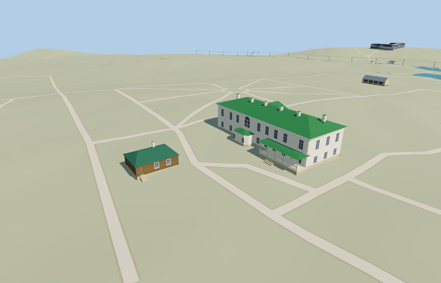

# White Kitchen — Yasnaya Polyana

Reviewed2026-10-25. **Complete medium-fi kitchen interpretation with photo-derived position, separate house context and explicit geographic uncertainty. The estate remains incomplete.**

## Built and inspected

Inspected 48 current portable/shared/medium-fi/native frames in one continuous author/inspect/fix pass. Complete low log kitchen, closed green hip/eaves, seated pale capped chimney, genuine recessed brown door and two white five-pane windows, corner log ends, modest plinth and five supported treads. The new close group photograph corrects each window to one upper transom over four lower panes; shortened only the central divider. Existing placement, roof, body, terrain and surrounding models remain as previously reviewed. The native context view includes the already reviewed Tolstoy House at its own location and terrain datum.

## Shared materials and LODs

Six existing 256px shared graphs: wood_log, wood_plain, metal_standing_seam, stone_limestone, storefront and plaster_lime. Seven material roles merge by graph; white frames and brown wood use vertex tints. Metric UVs, separate vertex streams, no embedded image/private atlas/new graph. The paired house/kitchen scene reads eight distinct graphs once each, sharing wood, roof, limestone and window materials. Unload releases all model geometry.

| Level | Triangles | Bytes | Draws |
| --- | ---: | ---: | ---: |
| skyline | 208 | 17864 | 1 |
| district | 242 | 25108 | 6 |
| street | 828 | 74516 | 6 |
| closeup | 1176 | 102812 | 6 |

Four source-authored LODs: 208/242/828/1176 triangles; initial skyline+district 42972 bytes. Skyline retains the complete hip, chimney, entrances/windows and supported stair. District adds shared textures and five-pane framing; near levels add restrained log/corner relief. At most six draws per kitchen. Synthetic lighting/distance/transition views pass; physical phone/laptop timings remain pending.

## Native placement and limits

Approximate photo-derived center[37.526028,54.076367] behind Tolstoy House; X southeast and front+Z southwest toward the photographed flower bed. The kitchen is absent from both the retained PMTiles and the current standard OSM neighborhood query. Unrelated toilet way167382259 was rejected. It owns/replaces no native building and intersects none at levels13/14/15. The single-model pass retained all243resident/295wider native buildings. The final paired pass separately replaces only Tolstoy House35184471786282 and keeps all242resident/294wider independent buildings, original approaches/roads, DEM samples and40070.675m²native water. House/kitchen roots differ0.680791m. Failed loading retains all243original buildings and kitchen ground; unload releases geometry and restores ground after water unload.

Original photo/aerial interpretation, not a mapped or surveyed footprint. Position is estimated within about5m and facing about15degrees; these are author estimates, not measured error bounds. Body9.6x7m, wall2.45m, hip ridge4.05m and chimney5.2m are visual estimates. Hidden rear, exact opening dimensions, roof pitch, historical levels and chimney placement remain reconstructed. Coarse native terrain varies0.86m and exposes more plinth/five steps than the ground photograph establishes; no sloped floor/roof or custom DEM is used. The adjacent icehouse and woodshed remain separate unfinished inventory.

## Rebuild and checks

Three deterministic source-local programs are registered in source.json and asset-build.json. Targeted generation/import, four derivatives, generator --check, strict medium-fi, scene validation and30-tick simulation passed. Six GLBs: zero Khronos errors/warnings;116 mesh probes and48 inspected frames. Map levels13/14/15 contain no native footprint intersection. The kitchen owns and replaces no native building. Exact pins: [qa.json](qa.json).

## References

[Museum White Kitchen photograph](https://www.ypmuseum.ru/object/lednik-belaya-kuhnya-drovyanoy-saray), photographer/date unstated, viewed only. No photograph pixels retained or used as texture. [Viewed aerial reference](https://www.google.com/maps/@54.076364,37.526021,20z/data=!3m1!1e3), Airbus/Maxar attribution as displayed; capture date unstated. Standard OpenStreetMap/Mapzen terrain retained. No aerial pixels or native footprint geometry copied.
