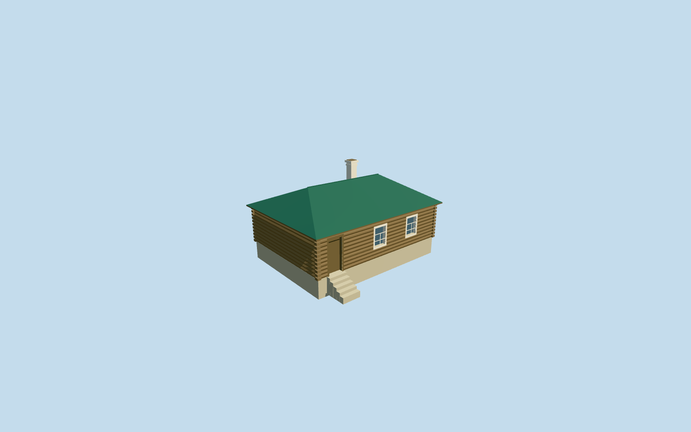

# White Kitchen — Yasnaya Polyana

Complete independent medium-fi White Kitchen exterior: low log shell, closed green hipped standing-seam roof, pale capped chimney seated through the roof, one real recessed wooden door, two real recessed white-framed divided windows, log corner ends, modest plinth and supported low threshold. Photo/aerial interpretation, with explicit positional and hidden-detail uncertainty. No adjacent icehouse/woodshed, planting, sign lettering, people or copied photo pixels are baked in.

## Evidence and reconstruction

Published dimensions and reconstructed details are separated in spec.json. Primary references:

- [Reference](https://www.ypmuseum.ru/object/lednik-belaya-kuhnya-drovyanoy-saray)
- [Reference](https://www.google.com/maps/@54.076364,37.526021,20z/data=!3m1!1e3)
- [Reference](https://commons.wikimedia.org/wiki/File:Хозяйственные_постройки_-_Кухня.jpg)

Complete independent medium-fi White Kitchen exterior: low log shell, closed green hipped standing-seam roof, pale capped chimney seated through the roof, one real recessed wooden door, two real recessed white-framed divided windows, log corner ends, modest plinth and supported low threshold. Photo/aerial interpretation, with explicit positional and hidden-detail uncertainty. No adjacent icehouse/woodshed, planting, sign lettering, people or copied photo pixels are baked in.

## Model and axes

1,176 triangles; 2,578 vertices; 6 material groups; 110,796 bytes. Native bounds: -6.475, -0.718, -6.421 to 6.237, 5.672, 6.421. Source hash: `sha256:52dfda61f5f51dca0ac94a18e746763eb327927772a0ed87a5002df2d07714ec`.

{"x":"east","y":"up","z":"south"}

The geographic proposal uses exact-QID OpenStreetMap evidence. Map-derived orientation and estimated architectural details require real-site visual review; preview eligibility is distinct from geographic/fidelity approval. Map attribution: © OpenStreetMap contributors, ODbL-1.0.

## Reproduce

Run `node content/worldgen/source/places/uc/ucd/white_kitchen_yasnaya_polyana/models/generate-white-kitchen-yasnaya-polyana.mjs --ids=white_kitchen_yasnaya_polyana` (or add `--check`). The generator preserves manually edited masters by checking their baseline hashes. Import through the standard authored-model workflow with optimization disabled; then capture all QA cameras, including shared-surface views.

## Pending work

- Complete independent medium-fi White Kitchen exterior: low log shell, closed green hipped standing-seam roof, pale capped chimney seated through the roof, one real recessed wooden door, two real recessed white-framed divided windows, log corner ends, modest plinth and supported low threshold. Photo/aerial interpretation, with explicit positional and hidden-detail uncertainty. No adjacent icehouse/woodshed, planting, sign lettering, people or copied photo pixels are baked in.
- The museum group photograph identifies the central low log White Kitchen, green hip, pale chimney, left wooden door and two divided white windows. Ordinary aerial imagery shows the matching separate green roof in the service courtyard behind Tolstoy House, with the southwest flower bed matching the ground photo. The retained PMTiles and current OSM neighborhood map omit this footprint; reject toilet way167382259 as unrelated. Photo-derived roof center[37.526028,54.076367] and9.6x7m plan are author estimates, about5m positional/15degree facing uncertainty, not an OSM or surveyed footprint. X southeast follows the visible roof; front+Z southwest faces the flower bed. Existing mapped buildings stay independent.
- Photo-led2.45m log walls, green hip ridge4.05m and pale chimney cap5.2m above one level floor. Door/window dimensions, hidden rear, roof pitch, chimney offset and course count are reconstructed. Standard native ground varies0.86m; floor0.4673049077492806m above the outside provider and supported low treads approximate contact. No sloped roof/floor or surveyed historical level claim.
- Retained Protomaps20261020 and Mapzen201x201/6m terrain. Outside southwest garden control[0,6] gives224.73946974947046m datum. There is no mapped kitchen footprint to own or replace. Preserve all243resident/295wider independent buildings, original roads, DEM samples and ponds. Cut only the reconstructed occupied kitchen footprint; low threshold treads seat into original soil, leaving the surrounding courtyard open.

This bundle follows the medium-fi standard. Medium-fi appearance and geographic fit are reviewed separately. Hash-bound visual acceptance is recorded separately after capture inspection.
