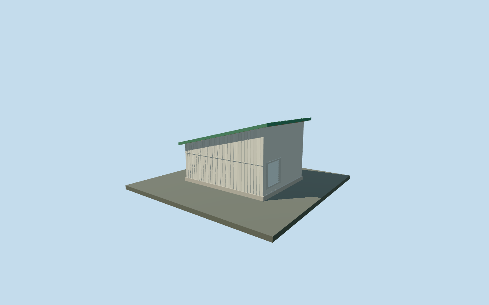

# Woodshed — Yasnaya Polyana

Separate service-courtyard shed with two courses of white vertical boards, green single-slope sheet roof, stone sill and recessed high-end louver panel.

## Evidence and reconstruction

Published dimensions and reconstructed details are separated in spec.json. Primary references:

- [Reference](https://ypmuseum.ru/object/lednik-belaya-kuhnya-drovyanoy-saray)
- [Reference](https://artsandculture.google.com/streetview/state-memorial-and-natural-preserve-leo-tolstoy-museum-estate-yasnaya-polyana-exterior/QgE4EprFLI_giw)
- [Reference](https://www.google.com/maps/@54.07631,37.52606,20z/data=!3m1!1e3)

Original mesh with shared standing-seam metal, painted timber and weathered stone surfaces. Reference photographs provide geometry and color guidance.

## Model and axes

1,162 triangles; 2,324 vertices; 3 material groups; 100,124 bytes. Native bounds: -2.550, -0.530, -2.060 to 2.590, 3.161, 2.060. Source hash: `sha256:f98e9878c715deaf7e7d6b0ed7d62fe16fedce8aa40bdd5ed0663605873053e0`.

{"x":"Low end northeast toward the high louvered end","y":"Up","z":"Boarded front southeast toward the courtyard"}

Two views in the museum exterior tour place the boarded shed beside the white garden wall, west of the White Kitchen. The high louver end faces northeast. The photo rays use two White Kitchen eave corners and the rear of Tolstoy House to align the photos to the aerial view. The native PMTiles lacks the shed outline and supplies independent path and building context. The stone sill is raised 0.17 m from the terrain-relative center sample. The foundation reaches below the archived standard terrain at all four corners. The model leaves the native terrain, path and nearby buildings intact.

## Reproduce

Run `node content/worldgen/source/places/uc/ucd/woodshed_yasnaya_polyana/models/generate-woodshed.mjs --ids=woodshed_yasnaya_polyana` (or add `--check`). The generator preserves manually edited masters by checking their baseline hashes. Import through the standard authored-model workflow with optimization disabled; then capture all QA cameras, including shared-surface views.

## Pending work

- Location and orientation come from an approximate photo reconstruction with partially obscured aerial context. The footprint, panels and heights are exterior estimates. The museum names the three courtyard buildings as a group. The assignment of this boarded building as the woodshed follows the contrasting kitchen and icehouse in the tour.
- The interior, concealed rear details and exact terrain levels are approximate.

This bundle follows the medium-fi standard. Medium-fi appearance and geographic fit are reviewed separately. Hash-bound visual acceptance is recorded separately after capture inspection.
