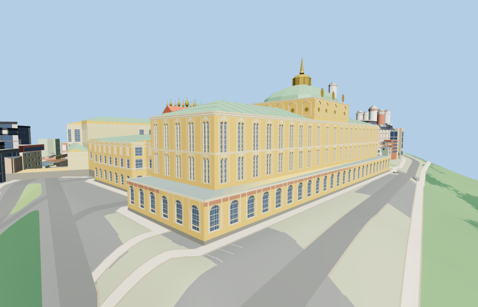

# Grand Kremlin Palace

The Grand Kremlin Palace includes the south arcade, green central crown, the connected northern Terem ranges and their gold cupolas. The full principal plan preserves the irregular open court.

The palace retains its signed OSM relation footprint and 157 m datum. A bounded grade fits the west, south and east edges. The principal floor stands 0.72–1.15 m above the sampled rendered approaches. The native east path runs beside the lower arcade.

The viewer replaces 255 grouped palace records and retains 1,306 surrounding records, 220 transportation records and the native water in the local fixture. A failed download restores the original palace records. Unload releases model geometry and restores ground and land cover.

| Detail level | Triangles | Download bytes | Draws |
| --- | ---: | ---: | ---: |
| skyline | 950 | 89,120 | 1 |
| district | 2,859 | 267,196 | 5 |
| street | 15,393 | 1,432,892 | 6 |
| closeup | 52,673 | 5,108,628 | 7 |

Skyline and district total 356,316 bytes. Six GLBs and 230 placement probes passed. The review covers 71 current renders.

The court elevations and exterior heights are estimates using the retained map, standard elevation terrain and ordinary photos.

Cathedral Square, the independent churches, the river slope and the Kremlin perimeter remain basemap context. Ornament and concealed roofing are simplified. Isolated turntables expose foundations that sit below the viewer’s fitted grade.

[Mapped site frame](map-frame.json) · [Terrain fit](site-fit.json) · [QA evidence](qa.json)
