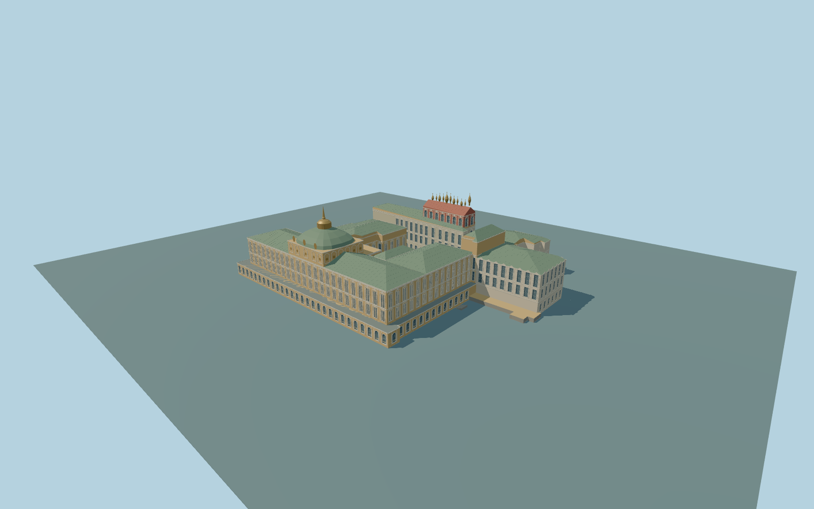

# Grand Kremlin Palace

Complete principal Grand Kremlin Palace exterior mapped by relation225033: yellow/white south facade and stepped lower arcade, green hipped roofs, raised central pavilion with domed crown and gold lantern/finial, east and west court returns, internal hall, northeastern faceted hall, connected historic northern/Terem ranges with original red roof, small gold cupolas and angled northwest return. Preserve the actual irregular open court. Independent Annunciation and other Cathedral Square churches, bell tower, modern State Kremlin Palace, western independent buildings and Kremlin perimeter walls/towers remain native context. Original simplified geometric trim; no copied emblems, sculpture, lettering or interiors.

Rebuild: `node packages/worldgen/scripts/generate-grand-kremlin-palace.mjs`;append `--check` for exact source bytes. Select import/LOD/placement with `--ids=grand_kremlin_palace`. Detailed source and four browser tiers are separate ignored GLB outputs.

Complete principal Grand Kremlin Palace exterior mapped by relation225033: yellow/white south facade and stepped lower arcade, green hipped roofs, raised central pavilion with domed crown and gold lantern/finial, east and west court returns, internal hall, northeastern faceted hall, connected historic northern/Terem ranges with original red roof, small gold cupolas and angled northwest return. Preserve the actual irregular open court. Independent Annunciation and other Cathedral Square churches, bell tower, modern State Kremlin Palace, western independent buildings and Kremlin perimeter walls/towers remain native context. Original simplified geometric trim; no copied emblems, sculpture, lettering or interiors.

Approximate157m standard global Terrarium datum,158m principal exterior floor. Native22.5m upper range,7m lower arcade,15.5m west return,23m northern historic range and31m raised Terem group guide massing. Original picture-guided main roof/pavilion and gold finials supplement incomplete roof heights. Four unchanged standard global DEM tiles. One small supported eastern transition meets the sampled field; the unsupported western stair was removed after inspecting terrain renders; historic grades and heights are approximate.

Three ordinary pictures inspected. Concealed courtyard elevations, historic northern roofs/cupola inventories, window counts, ornamental trim and exact historic grades are medium-fi approximations. The principal relation includes the connected northern historic ensemble; independent adjacent churches remain native. Physical device timings and numerical LOD errors remain unmeasured. Native terrain review confirms an oversized western exposed foundation caused by the coarse field and fixed common floor. Ground fit remains pending; no historic west entrance or stair is asserted.

Seven existing shared256px plaster,limestone,granite,painted metal,copper,wood andwindow-grid graphs. Metric UVs/linear colors, zero private or embedded images and seven draws maximum. Skyline retains the complete principal plan, court, main green crown and six representative northern cupolas; district uses closed window proxies; street has closed recesses; close-up adds paired openings,pilasters,original trim,roof seams and11 cupolas. The source retains finer curves and framing. Physical timings and numerical LOD errors remain unmeasured.

Original geometry:repository license. Map:© OpenStreetMap contributors,ODbL-1.0;Protomaps. Standard terrain:terrain-grid.json. Ordinary pictures stay local and are not redistributed or used as textures. Current acceptance:qa.json.
