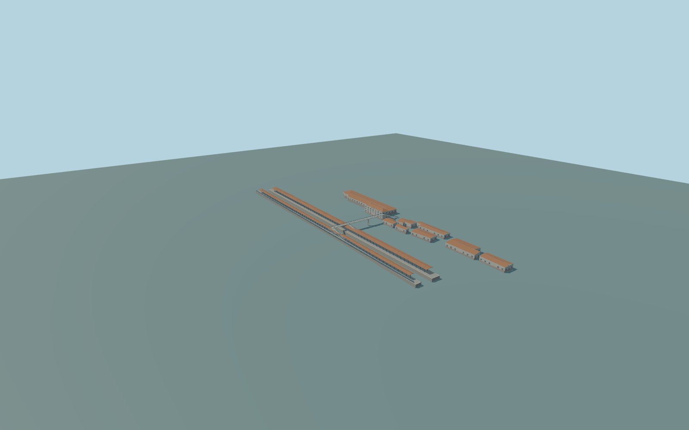

# Kuskovo railway station

Complete Kuskovo railway-station passenger ensemble:both entire mapped island/side platforms andphoto-observed longbrown pitchedcanopies withbluepost/truss families;the complete mapped openconcrete pedestrian crossing withplatform/side-street stairflights;the grey-sided hipped-roof station office andadjacent lowservice/ticket/annex buildings ontheNNW side. Preserve theindependentindustrialcompound tothenorthwest,thewholefreightyard/railnetwork,privatehouses southoftheline,park,streets andother separatebuildings. No trains,people,brands,lettering,ticket-machine interfaces oroperationalrailway interiors.

Rebuild: `node packages/worldgen/scripts/generate-kuskovo-station.mjs`;append `--check` for exact source bytes. Select import/LOD/placement with `--ids=kuskovo`. Detailed source and four browser tiers are separate ignored GLB outputs.

Complete Kuskovo railway-station passenger ensemble:both entire mapped island/side platforms andphoto-observed longbrown pitchedcanopies withbluepost/truss families;the complete mapped openconcrete pedestrian crossing withplatform/side-street stairflights;the grey-sided hipped-roof station office andadjacent lowservice/ticket/annex buildings ontheNNW side. Preserve theindependentindustrialcompound tothenorthwest,thewholefreightyard/railnetwork,privatehouses southoftheline,park,streets andother separatebuildings. No trains,people,brands,lettering,ticket-machine interfaces oroperationalrailway interiors.

Exact current platform polygons,bridgepath andthree stairalignments are retained fromstandard PMTiles. The wholelongcanopy profiles,bluepost/trusses andgrey-sided stationoffice come fromordinary2023/2025 photographs. Absent mapheights areexplicit estimates:closed-office/annex floors1.25m,westernwarehousefloor2.8m,officeeave10.25/ridge12.8m,otherroofs4.7–7.3m,platformfloor3.3m,canopyeave7.6/ridge8.4m,bridgefloor9/handrail10.2m ononecommon2Dfielddatum. Narrowstairheadroomslots areanexplicit constructioninterpretation preservinganopenroutethroughthecanopies,not acopiedfloorplan. Exactcurrenthiddenfacades,roomuses,roofinventory,raillevels andaccessiblethresholds remainunverified. One unchanged global field sample outside the office row at[-50,-70],150.377775m,defines commonY=0. All source levels are fixed relative to this common reference. No per-part runtime offset or terrain flattening.

Three ordinary 2023/2025 exterior pictures and standard PMTiles. The two complete mapped platforms, open crossing and three mapped stair alignments are retained. Unmapped canopy middle inventory, secondary building functions, hidden facades, roof sections and source heights remain explicit medium-fi interpretations. No exact railway-clearance, current works or accessible-route certification. Independent industrial property, park and private houses remain separate. Physical laptop/phone/dense-city timing and numerical LOD errors remain unmeasured.

Six existing shared 256px graphs: concrete_plain, siding_lap, stone_granite, metal_standing_seam, metal_painted and window_grid. At most six merged near semantic groups; metric UVs and linear colours. No embedded or private images. Actual glazing alone uses window_grid; opaque siding, roofs, concrete, steel and painted frames retain their proper slots. Four whole-station tiers retain both entire platforms, all building masses, the full crossing and three stair flights. Near tiers add actual window/door recesses, roof ribs/posts/braces, two-sided bridge/stair railings, soffit purlins, platform edge bands and office frames. The detailed master further refines source sections and support/frame inventory. Stair headroom slots follow the mapped flight positions.

Original geometry:repository license. Map:© OpenStreetMap contributors,ODbL-1.0;Protomaps. Standard terrain:terrain-grid.json. Ordinary pictures stay local and are not redistributed or used as textures. Current acceptance:qa.json.
