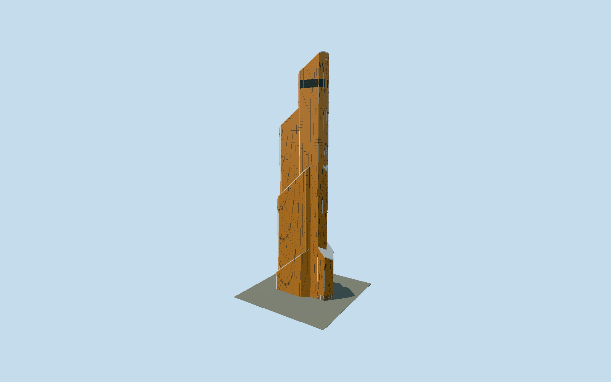

# Mercury City Tower

Moscow’s copper-gold stepped tower with seven individually mapped sloped volumes, white folded edge bands, dense unitized glass, upper media screens and its pointed street entrance.

## Evidence and reconstruction

Published dimensions and reconstructed details are separated in spec.json. Primary references:

- [Reference](https://www.mercury-city.com/en/about/architecture/)
- [Reference](https://www.mercury-city.com/en/mediafacade/)
- [Reference](https://www.yuandacn.com/index.php/en/projects-cn-2/146-overseas/europe/russia/337-mercury-city-tower-2.html)
- [Reference](https://www.skyscrapercenter.com/building/wd/265)
- [Reference](https://www.openstreetmap.org/way/52929368)

No third-party geometry, photograph or bitmap texture is embedded. Shared surface graphs come from the central library; vertex tints carry model colors. Glazing uses PBR materials; transparent surfaces are declared per model.

## Model and axes

16,573 triangles; 49,687 vertices; 3 material groups; 1,989,968 bytes. Native bounds: -47.186, 0.000, -22.263 to 47.240, 338.885, 22.273. Source hash: `sha256:176eade9ffaa175109c569101acbdcd7b4434a8fc7849f9d1172cd8acc028c9a`.

{"up":"+Y","longitudinal":"+X southeast toward pointed low nose","front":"+Z southwest","origin":"Exact-QID mapped ground-contact footprint frame"}

The geographic proposal uses exact-QID OpenStreetMap evidence. Map-derived orientation and estimated architectural details require real-site visual review; preview eligibility is distinct from geographic/fidelity approval. Map attribution: © OpenStreetMap contributors, ODbL-1.0.

## Reproduce

Run `node packages/worldgen/scripts/generate-signature-towers.mjs --ids=mercury_city_tower` (or add `--check`). The generator preserves manually edited masters by checking their baseline hashes. Import through the standard authored-model workflow with optimization disabled; then capture all QA cameras, including shared-surface views.

## Pending work

- Original16573-triangle/1989968byte detailed master remains reproducible from unchanged global recipe. Seven independently mapped volumes, opposing sloped roofs, copper glazing, white folded aluminum bands, dark media faces and pointed low entrance retained.338.824m fabricator/338.8m CVU,75floors/2013; tiny raised frame reaches338.885m. Facade75000m2 contractor refers to curtain wall, owner180000m2 refers to building area. Glass pitch1.42m/4.05m, white band width1.2m, corner stripe2.5percent of edge and media datum294–304.5m are photo reconstructions, not surveyed dimensions. Owner media1350m2/floors67–68/four faces informs neutral dark bands; advertisements excluded. Exact roof mechanical equipment, doors, interiors and temporary decorations excluded. Two canonical256px concrete/paintedmetal graphs shared; opaque copper glass palette; zero embedded images and no photographic facade texture. Terrain slope and physical device/dense-city performance unmeasured.

This bundle follows the medium-fi standard. Medium-fi appearance and geographic fit are reviewed separately. Hash-bound visual acceptance is recorded separately after capture inspection.
