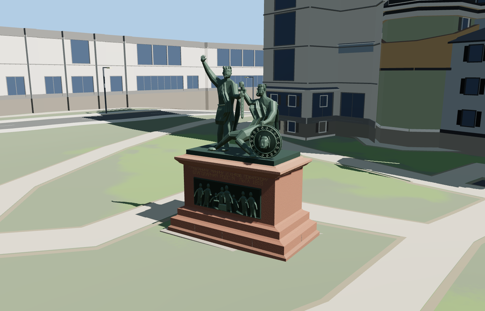

# Monument to Minin and Pozharsky

Minin stands in a belted tunic with one open hand raised. Pozharsky rises from his seat with the round shield while both figures hold the upright sword. The red granite pedestal has a gilt dedication and two distinct bronze reliefs, an assembly of donors on the front and a mounted group on the rear.

The 14,811-triangle source master rebuilds from the editable geometry. The four runtime levels have 926, 3,404, 8,459, 12,311 triangles. Skyline and district total 422,140 bytes, or 149,216 bytes compressed with gzip. All six GLBs validate with zero errors, warnings or embedded images.

The viewer places the granite footing at the named monument point and keeps all 586 building and 152 transportation records in the captured site. Every level preserves the standing figure, seated figure, raised hand, sword, shield and two inset bronze panels. District through close-up add raised relief geometry. A failed load preserves the mapped plaza. Eviction releases the model geometry.

Inspected 26 geographic and 12 standalone views, including both reliefs, the shield, the clasped hands and the granite footing. The State Historical Museum gives 4.5 m for the bronze group. Pedestal dimensions, body depths and hand positions are scaled from the photographs. The named PMTiles monument point fixes the center. The neighboring footway and cathedral provide the signed pedestal axis. Individual photographic bearings are approximate. The source geometry preserves the standing and seated figures, common sword, shield, two narrative reliefs and gilded lettering. Portrait likenesses, minor ornament and details in the relief crowds are simplified. The asset includes the small paved footing within the mapped site. Surrounding flower beds, railings, paving and cathedral are site context. Physical-device timings remain unmeasured.

Run `node packages/worldgen/scripts/generate-monument-to-minin-and-pozharsky.mjs --check --ids=monument_to_minin_and_pozharsky` to confirm the source rebuild.
