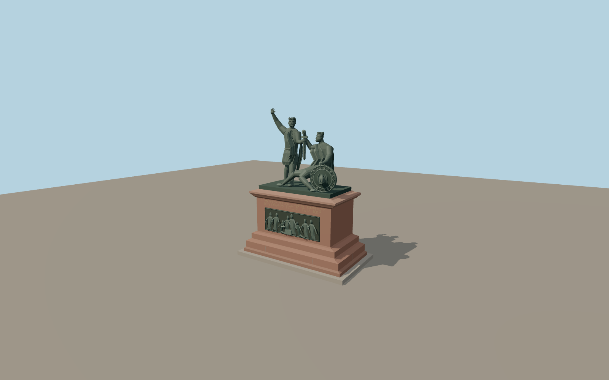

# Monument to Minin and Pozharsky

Minin stands in a belted tunic with one open hand raised. Pozharsky rises from his seat with the round shield while both figures hold the upright sword. The red granite pedestal has a gilt dedication and two distinct bronze reliefs, an assembly of donors on the front and a mounted group on the rear.

Run `node packages/worldgen/scripts/generate-monument-to-minin-and-pozharsky.mjs` to rebuild the source master. Append `--check` to compare the exact bytes. Use `--ids=monument_to_minin_and_pozharsky` for targeted import, LOD generation and placement.

The State Historical Museum gives 4.5 m for the bronze group. Pedestal dimensions, body depths and hand positions are scaled from the photographs.

The named PMTiles monument point fixes the center. The neighboring footway and cathedral provide the signed pedestal axis. Individual photographic bearings are approximate.

The source geometry preserves the standing and seated figures, common sword, shield, two narrative reliefs and gilded lettering. Portrait likenesses, minor ornament and details in the relief crowds are simplified.

The asset includes the small paved footing within the mapped site. Surrounding flower beds, railings, paving and cathedral are site context.

Original geometry follows the repository license. Map data is © OpenStreetMap contributors under ODbL-1.0 via Protomaps. Terrain samples are described in terrain-grid.json. Ordinary pictures stay local and are not redistributed or used as textures. Current acceptance is recorded in qa.json.
