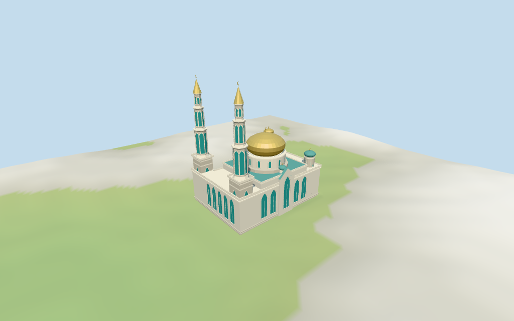

# Moscow Cathedral Mosque

Individual medium-fi modern main Moscow Cathedral Mosque: broad golden onion dome, two tall stepped minarets with gilded cones, smaller gold/teal corner turrets, pale multi-level body, nested tall turquoise pointed windows, cornice bands and simplified parapets. Raw main outline retained; all detailed plans and heights estimated from two pictures. Six existing shared 256² graphs, seven merged roles and four budgeted browser LODs. Separate northern low building, city, fine artwork and unseen interiors remain outside this asset.

## Evidence and reconstruction

Published dimensions and reconstructed details are separated in spec.json. Primary references:

- [Reference](https://commons.wikimedia.org/wiki/File:Moscow_Cathedral_Mosque_01-2016.jpg)
- [Reference](https://commons.wikimedia.org/wiki/File:Moscow_Cathedral_Mosque,_22_April_2021.jpg)

Six existing shared 256² stucco, marble, continuous limestone, standing-seam metal, cast bronze and wood graphs serve seven merged roles including opaque turquoise window fields. Metric UVs, linear tints, no embedded images, unique facade atlases or copied calligraphy.

## Model and axes

30,742 triangles; 92,226 vertices; 7 material groups; 3,693,292 bytes. Native bounds: -33.914, -0.594, -25.646 to 33.853, 80.279, 26.420. Source hash: `sha256:bd0b995d714023f5772098858e81887ac7687075872cf48d7735774288cc1665`.

{"x":"east smaller turrets","y":"up","z":"south gabled façade"}

Normal viewer DEM datum 154.03982251882553 m; working floor 0.2785621010920522 m is the median of 92 outside-perimeter samples at 1 m offset plus 0.3 m. 327 raw footprint samples span -0.34857956631719844..0.9389330536048419 m. Adaptive footings follow the actual outline. Preview terrain seats the footprint and 1.5 m margin; the U-shaped indentation stays open for the separate northern building. Model paving covers the raw-outline ground cutout. Precise stairs, thresholds, street retaining walls, ramps, basement/shop levels, paving grades and terrain joins remain unverified.

## Reproduce

Run `node packages/worldgen/scripts/generate-additional-landmarks.mjs --ids=moscow_cathedral_mosque` (or add `--check`). The generator preserves manually edited masters by checking their baseline hashes. Import through the standard authored-model workflow with optimization disabled; then capture all QA cameras, including shared-surface views.

## Pending work

- Retained exact way 128264422 / Q3679864 is current viewer building 35184500353254. Its nine current outer vertices, original anchor and heading remain unchanged. Positive X is approximately east, positive Z approximately south. Pictures from the northwest and south place the two tall minarets on the western side, the main gold dome over the central prayer block, and smaller corner turrets toward the east. Current PMTiles have no height tags or independent roof/tower parts. All internal plans, turret positions, facade divisions and vertical dimensions are picture estimates. The separate northern low building 35184418943116 remains host content; its footprint is preserved rather than absorbed into the main mosque.
- No retained or current mapped height values are available. Explicit visualization estimates: main body eaves 22 m, stepped central support 26 m, drum 28–35 m, broad golden onion 35–47 m and finial 50 m. Two western minarets rise from rectangular 31 m bases through stepped octagonal window tiers near 33–48, 50–61 and 63–69 m, to gilded cones at 78 m and finials at 80 m. Northeastern smaller gold turret top about 40 m; southeastern teal turret top about 34 m. Roof steps, minor teal caps, cornices, parapets and pointed gables are estimates. These are visualization dimensions, not surveyed facts. Fine calligraphy, lattice patterns, sculpture and unseen interiors omitted.
- Normal viewer DEM datum 154.03982251882553 m; working floor 0.2785621010920522 m is the median of 92 outside-perimeter samples at 1 m offset plus 0.3 m. 327 raw footprint samples span -0.34857956631719844..0.9389330536048419 m. Adaptive footings follow the actual outline. Preview terrain seats the footprint and 1.5 m margin; the U-shaped indentation stays open for the separate northern building. Model paving covers the raw-outline ground cutout. Precise stairs, thresholds, street retaining walls, ramps, basement/shop levels, paving grades and terrain joins remain unverified.
- Individual modern main mosque; the separate northern low building stays host content. All heights, tower/cap positions, roof subdivisions and facade rhythms are estimates. Opaque turquoise panes and shallow door fields stop before unseen interiors. Fine calligraphy, lattice/art, actual baluster patterns, detailed crescents, current finish, engineering and physical-device timings remain unverified. Near finials use original chunky crescent silhouettes; far levels use spikes.

This bundle follows the medium-fi standard. Medium-fi appearance and geographic fit are reviewed separately. Hash-bound visual acceptance is recorded separately after capture inspection.

## Additional geographic data

©OpenStreetMap contributors; Protomaps; Mapzen/USGS terrain tiles.
