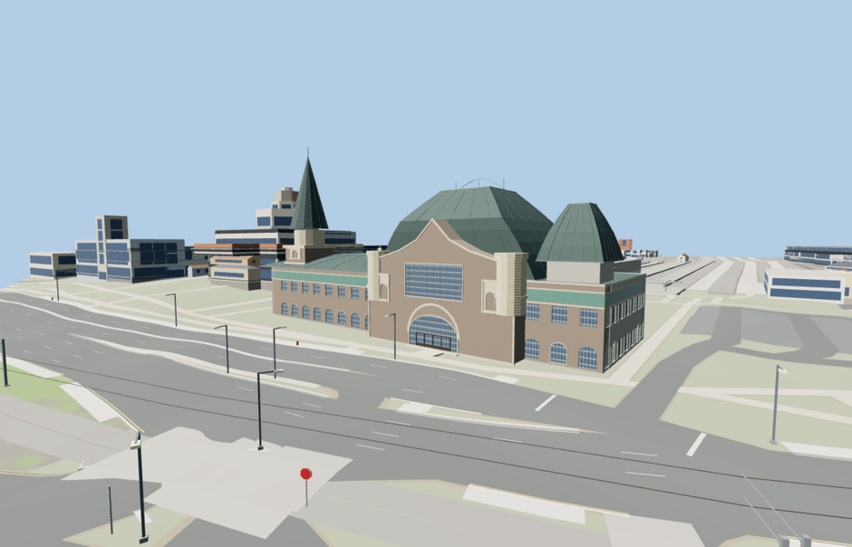

# Moscow Yaroslavsky railway station

The named passenger terminal has its historic western spire, eastern flared roof, arched entrance, turquoise frieze, right turret, attached concourse, boarding canopy and eight whole mapped passenger platforms.

The stone entrance ramp meets the rendered sidewalk within 3 mm at the sampled points. The adjusted apron joins all eight platform islands and clears 12 mapped buffers. Three bounded grades fit the station and boarding area to the retained terrain. The local field remains within 4 mm of the original beyond the grading shoulders at the sampled points.

The native fixture retains 316 neighboring building records, 585 road and rail records and two mapped water inputs. A failed load keeps the mapped station and canopy. A separate replacement test covers all three owned fragments and 1,494 independent native components. 796 placement checks passed.

| Detail level | Triangles | Download bytes | Draws |
| --- | ---: | ---: | ---: |
| skyline | 990 | 80,060 | 1 |
| district | 2,406 | 205,928 | 8 |
| street | 7,575 | 678,200 | 8 |
| closeup | 17,693 | 1,668,792 | 8 |

The first two levels total 285,988 bytes. Six GLBs validated with zero errors or warnings. Four focused tests passed and 71 views were reviewed.

The forecourt and track terrace are visual fits to existing map geometry, four standard elevation tiles and ordinary station photos. Rail elevations, dwelling gradients, and entrance dimensions are approximate.
The signed model includes the historic headhouse, attached rear concourse, boarding canopy and eight platform islands. The independent Leningradsky and Kazansky terminals and surrounding roads remain separate. Interiors, trains, signs and overhead wiring remain outside the authored scope.

[Site controls](models/site-fit.json) · [QA evidence](qa.json)
