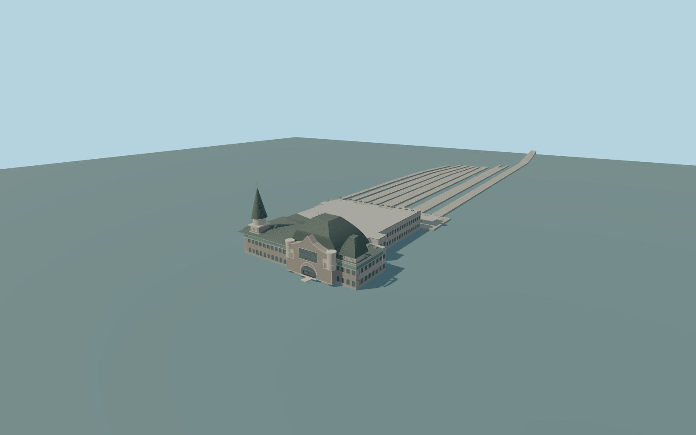

# Moscow Yaroslavsky railway station

Original exterior of the named Yaroslavsky passenger terminal, with its historic spire, arched entrance and flared east roof, attached rear concourse, boarding canopy and eight whole mapped passenger platform islands.

Rebuild: `node packages/worldgen/scripts/generate-moscow-yaroslavsky-station.mjs`;append `--check` for exact source bytes. Select import/LOD/placement with `--ids=moscow_yaroslavsky_railway_station`. Detailed source and four browser tiers are separate ignored GLB outputs.

The forecourt and track terrace are visual fits to existing map geometry, four standard elevation tiles and ordinary station photos. Rail elevations, dwelling gradients, and entrance dimensions are approximate.

The signed model includes the historic headhouse, attached rear concourse, boarding canopy and eight platform islands. The independent Leningradsky and Kazansky terminals and surrounding roads remain separate. Interiors, trains, signs and overhead wiring remain outside the authored scope.

Original geometry:repository license. Map:© OpenStreetMap contributors,ODbL-1.0;Protomaps. Standard terrain:terrain-grid.json. Ordinary pictures stay local and are not redistributed or used as textures. Current acceptance:qa.json.
