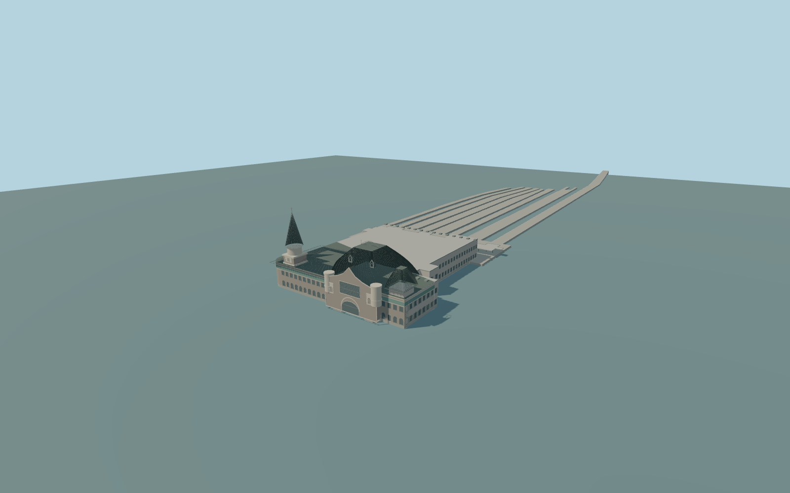

# Moscow Yaroslavsky railway station

Complete individual Yaroslavsky passenger-terminal exterior: the whole named historic front headhouse and connected modern rear concourse, the entire mapped comb-shaped rear boarding canopy and each physically connected mapped passenger platform. Preserve the independent Leningradsky terminal and its many detailed mapped facade parts to the west, Kazansky terminal across the square, postal/rail service properties, streets and rail network. The candidate reference coordinate is in the northern yard; the named passenger-terminal footprint supplies the model anchor. No trains, people, branding, lettering, ticket interfaces or navigable railway interiors. No imagined future shared canopy between the independent terminals.

Rebuild: `node packages/worldgen/scripts/generate-moscow-yaroslavsky-station.mjs`;append `--check` for exact source bytes. Select import/LOD/placement with `--ids=moscow_yaroslavsky_railway_station`. Detailed source and four browser tiers are separate ignored GLB outputs.

Complete individual Yaroslavsky passenger-terminal exterior: the whole named historic front headhouse and connected modern rear concourse, the entire mapped comb-shaped rear boarding canopy and each physically connected mapped passenger platform. Preserve the independent Leningradsky terminal and its many detailed mapped facade parts to the west, Kazansky terminal across the square, postal/rail service properties, streets and rail network. The candidate reference coordinate is in the northern yard; the named passenger-terminal footprint supplies the model anchor. No trains, people, branding, lettering, ticket interfaces or navigable railway interiors. No imagined future shared canopy between the independent terminals.

Standard 20261031 PMTiles physically associates the named Yaroslavsky Rail Terminal building/POI 52776559531195 with its complete two tile fragments and rear canopy 52776559531169. The ordinary front photo resolves asymmetric left spire, large eastern flared/tented roof, right turret, broad arched entry, grey-brown walls, pale trim and turquoise ceramic frieze. A 2026 yard picture establishes the open platform/track character but does not verify hidden terminal facades. Native main envelope height14m and rear canopy5m are retained as map facts; feature-specific roof/tower heights, wall bays, hidden facade details, floor/platform grades and current renovation state are explicit medium-fi estimates. Source hall and platform floors are +1.25m from one unchanged standard outside forecourt sample [10,69], 149.02778940000002m absolute datum. The native main envelope14m and boarding canopy5m are retained; western shaft19m/drum23.2m/spire42m/finial44.55m, broad eastern flared roof30.2m/crest32.7m and right turret26m are explicit picture-based estimates. Eight whole mapped platform islands are retained; a fixed transverse concrete boarding apron connects their noses to the rear canopy, without masking the rail corridor. Exact threshold, track-buffer and platform grades remain unverified.

Two ordinary front/yard photographs and current standard PMTiles. Hidden facades, interior organization, present renovation details, intermediate levels, exact decorative motifs and tower/roof heights are medium-fi interpretations. Native 14m main envelope and 5m boarding canopy are map facts. Passenger platforms and a transverse apron retain physical continuity. Exact railway clearances and threshold grades remain unverified; ordinary viewer terrain contact must be checked before readiness. Independent Leningradsky, Kazansky, postal/rail properties and streets remain separate. Physical-device/dense-city timing and numerical LOD errors remain unmeasured.

Eight existing shared 256px graphs: brick, concrete_plain, stone_limestone, tile_glazed, slate, metal_standing_seam, metal_painted and window_grid. Eight merged near groups and one far palette group, metric UVs and linear colours. No embedded/private images. Turquoise ceramic frieze uses tile_glazed; actual glazing uses window_grid; brick masonry, pale trim, dark slate, concrete and metal retain their proper slots. The frieze is a shared tinted material, not copied artwork. Four whole-station tiers retain the asymmetric spire/flared roof/right turret, historic front and modern concourse, full boarding canopy and eight mapped platform islands. Near tiers add actual recesses, arch frames, roof seams/dormers/crest, rounded piers, canopy supports/braces, platform edge bands and facade bays. Decorative details and hidden surfaces are explicit simplified interpretations.

Original geometry:repository license. Map:© OpenStreetMap contributors,ODbL-1.0;Protomaps. Standard terrain:terrain-grid.json. Ordinary pictures stay local and are not redistributed or used as textures. Current acceptance:qa.json.
