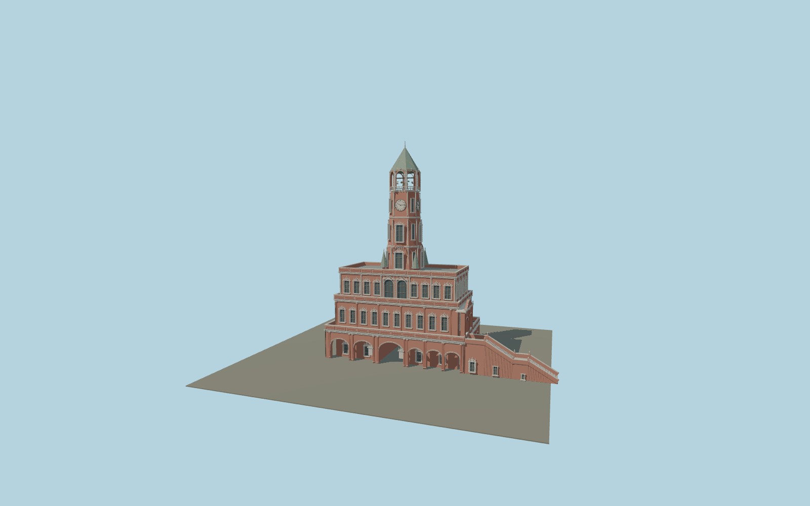

# Sukharev Tower

The model represents the tower’s 1930 museum exterior. It preserves the asymmetrical arcades, open central passage, exposed two-flight east stair, carved window surrounds, four clock faces and open belfry.

Placement uses the signed historical tower frame with approximately 7 m registration uncertainty. In the Earth viewer the reconstruction appears on 1926-01-06 and in 1930, is absent on 1926-01-05 and 1934-04-01, and is absent in undated and current views.

The current map supplies terrain and context. Modern roads and their signals are visible beside and through the historic ground-floor arcades. Present-day ground samples at the corners differ from the historical pavement plane by up to 1.87 m. The date-qualified placement depicts the tower’s 1930 exterior over a modern basemap.

The source regenerates byte for byte at 462,244 triangles. The four browser levels use 1,401, 2,067, 16,960 and 62,088 triangles. The first two total 237,376 bytes. Seven shared material graphs support the detailed exterior. The six GLBs contain zero embedded images.

The review covers 54 captures. All four tiers release their geometry on unload. An unavailable model leaves the basemap intact.

[Museum of Moscow photographs](https://online.mosmuseum.ru/moskva-404-1) · [Historical map registration](map-frame.json) · [QA evidence](qa.json)
