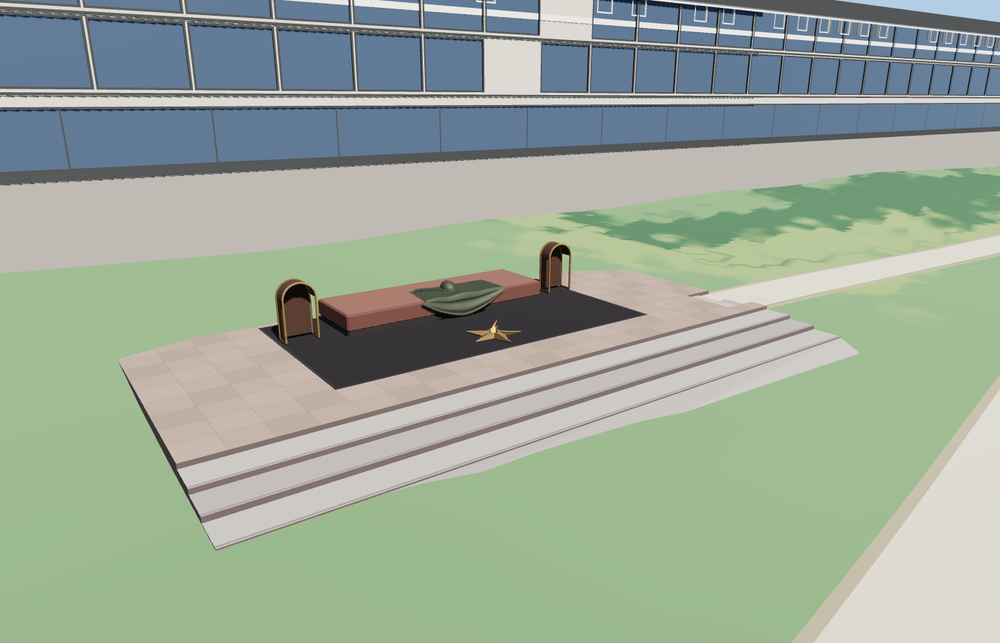

# Tomb of the Unknown Soldier

Tomb of the Unknown Soldier in Alexander Garden with its stepped granite approach, dark stone tomb, folded bronze banner, helmet, laurel, and the five-point Eternal Flame burner.

The 13,015-triangle source rebuilds byte for byte. Skyline, district, street and close-up use 779, 1,445, 4,419, 9,907 triangles. The first two tiers total 207,520 bytes. Six GLBs validated and 38 current views were inspected.

Each tier passes 15 approach-tread, five platform, five star-tip and three side-path probes. The largest sampled side-path join difference is 0.064 m. The viewer retains 142 neighboring buildings, 94 road and path records, and the original terrain and land cover. Failed loading leaves the mapped surroundings visible.

The footprint and terrain use map data. Internal dimensions, bronze sculpture and paving details use exterior photographs and visual estimates. The flame is a static 3D sculpture. The independent Kremlin wall, the adjacent memorials and vegetation remain in the host map. Physical-device timings are unmeasured.

Rebuild with `node packages/worldgen/scripts/generate-tomb-unknown-soldier.mjs`. Append `--check` to compare exact bytes. Use `--ids=tomb_of_the_unknown_soldier` for targeted import, LOD, placement and readiness.
