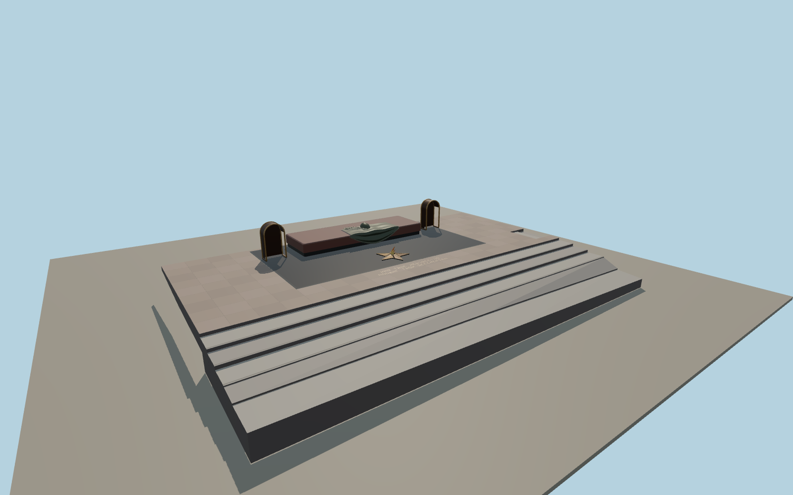

# Tomb of the Unknown Soldier

Tomb of the Unknown Soldier in Alexander Garden with its stepped granite approach, dark stone tomb, folded bronze banner, helmet, laurel, and the five-point Eternal Flame burner.

Run `node packages/worldgen/scripts/generate-tomb-unknown-soldier.mjs` to rebuild the source master. Append `--check` to compare the exact bytes. Use `--ids=tomb_of_the_unknown_soldier` for targeted import, LOD generation and placement.

The footprint and terrain use map data. Internal dimensions, bronze sculpture and paving details use exterior photographs and visual estimates.

The flame is a static 3D sculpture. The independent Kremlin wall, the adjacent memorials and vegetation remain in the host map.

Original geometry follows the repository license. Map data is © OpenStreetMap contributors under ODbL-1.0 via Protomaps. Terrain samples are described in terrain-grid.json. Ordinary pictures stay local and are not redistributed or used as textures. Current acceptance is recorded in qa.json.
