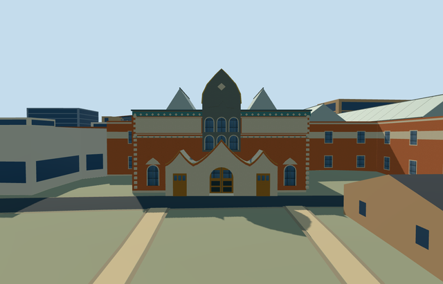

# tretyakov_gallery — Tretyakov Gallery, historic Lavrushinsky Lane complex

Reviewed 2026-10-22. **Completed medium-fi exterior with approximate native placement; Historic connected gallery ranges.**

## Built and inspected

Historic Lavrushinsky Lane Tretyakov Gallery with its connected northern gallery range: exact two-parent occupied footprint, orange-red lime-render walls, long cream inscription fields without copied lettering, teal patterned frieze, a tall gray keeled central facade with two tiers of three arched lights/abstract relief, three curved cream entrance gables edged in terracotta/gold, recessed central arched wooden door and two actual0.15m working treads. Eight reconstructed framed opaque glazed roof lanterns and light flat roof strips retain the gallery-roof silhouette. Two ordinary photographs and standard PMTiles guided one continuous author/inspect/fix pass. Corrected roof faces inheriting wall color, overlapping generic front trim, added treads and raised the whole-site camera; no restart as a separate research phase.

## Shared materials and browser LODs

Five existing256px graphs: plaster_lime orange-red walls, stone_limestone_raw cream surrounds/inscription panels/abstract gray relief, metal_painted roof membrane/opaque frosted lantern substitute/framework/frieze/edging, storefront opaque arched glazing, wood_plain doors. Painted metal substitutes for membrane and frosted roof glazing; blank/abstract fields replace lettering, mosaic imagery and sculpture. Six textured draws/one skyline draw; actual LOD costs below. No new graph/private atlas/embedded image. Linear tints, tangent-projected surfaces, cached graphs and separate POSITION/NORMAL streams retained; CPU/GPU byte accounting agrees. Each native textured run reads each graph once and unloads all model geometry.

| Level | Triangles | Bytes | Draws |
| --- | ---: | ---: | ---: |
| skyline | 876 | 80128 | 1 |
| district | 3732 | 343264 | 6 |
| street | 6284 | 563136 | 6 |
| closeup | 6284 | 563136 | 6 |

Four authored LODs 876 / 3732 / 6284 / 6284 triangles, within 1k / 4k / 16k / 64k caps. Initial skyline+district geometry 423392 bytes; shared material bakes cached separately. Six GLBs have zero Khronos errors/warnings; 108 actual geometry/contact probes and five actual PMTiles13/14/15 cases pass, including two detailed owned records. Inspected 48 current portable/shared/medium-fi/native frames, all LODs, failed loading, Economy/High and noon/late light. Physical device/dense-city timings remain pending.

## Geographic placement

Approximate native exterior fit reviewed. Q183334 plus relation1907261/native52776560040509 identifies the main historic gallery; connected northern relation1907269/native52776560040517 included. Own porch-midpoint anchor[37.620723992586136,55.74142573330042], heading0; internalX southeast along its mapped front, internalZ southwest into the ranges, baked to native east/south. Original grid201x201 at6m, front provider internal[0,-2.5], datum129.9305m, floor0.3m/two0.15m working treads. Boundary grades-2.034..+1.068m across both ranges leave a modest rear foundation/uphill burial. Only occupied two-parent footprint cuts ground/replaces map buildings; retain845 resident/1,062 wider independent records, engineering building, church, neighboring university and blocks. Original hill, roads and179,250.185980m² water retained; mapped ownership1micrometer/ground-only mask1mm quantized. Failure keeps847 originals; four LOD unloads restore ground/water and zero live model geometry. Controlled native fixture manually selects this asset; exact paving, historic thresholds/accessibility and roof layout remain approximate.

## Fidelity and limits

Photo-led medium-fi exterior, main historic gallery and connected northern range only. Map14m heights unqualified; working body10.4/cornice11.3/roof lantern14.4/keeled facade16.6m reconstructed. Facade inventory, cream panel/frieze motifs, keels/three gables and arched lights simplified; abstract relief/blank bands replace heraldic sculpture, mosaics and inscriptions. Hidden rear elevations and eight-lantern count/layout are reconstructed inside actual mapped ranges; no measured historical roof claim. Painted metal is a shared substitute for membrane/frosted roof glazing. Two0.15m treads are working proxies, not certified historic access. Independent engineering building, church and modern detached gallery retained as map context. No furnished exhibitions, paintings, statue likeness, copied pixels/signs or operational gallery. Physical device/dense-city timings remain pending.

## Targeted checks

Selected generation/import/placement, strict medium-fi, scene/sim30 and recipe lint pass. Sim30 sha256:001cc6ed68a08ef27a2b0565db362ff351f7218019766a0b1c48f3b25a386c1b. Pins: [qa.json](qa.json); [source controls](map-frame.json).

## Viewed references

- https://commons.wikimedia.org/wiki/File:Moscow_05-2012_TretyakovGallery.jpg — A.Savin; 2012-05-28; CC-BY-SA-3.0. Viewed only; no copied pixels.

- https://commons.wikimedia.org/wiki/File:20180711_Main_building_of_Tretyakov_Gallery_-_exterior_01.jpg — Sergey A. Demidov; 2018-07-11; CC-BY-4.0. Viewed only; no copied pixels.

- https://www.openstreetmap.org/relation/1907261 — historic gallery footprint, ©OpenStreetMap contributors ODbL-1.0. Standard PMTiles/Mapzen, no bespoke terrain research.

## Completion checklist

- [x] Source rebuild, import, four authored LODs and existing shared materials.
- [x] Current actual source/shared/native views, geometry and lifecycle checks.
- [x] Independent identity, map orientation and approximate hillside placement.
- [x] Connected historic gallery ranges; detached buildings remain independent.
