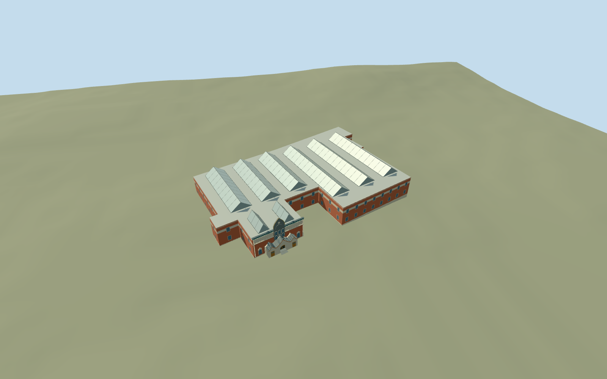

# Tretyakov Gallery, historic Lavrushinsky Lane complex

Historic Lavrushinsky Lane Tretyakov Gallery and contiguous northern gallery range: original connected map footprint, orange-red rendered walls, cream inscription panels without copied text, dark patterned frieze, raised gray keeled central facade with arched lights/abstract relief, three scalloped entrance gables and a genuine recessed central arched doorway, and repeated framed glazed roof lanterns. Exterior only. Preserve the independent engineering building, church, modern detached gallery and neighbors. No furnished galleries, paintings, statue likeness, copied signs, lettering or heraldic artwork.

## Evidence and reconstruction

Published dimensions and reconstructed details are separated in spec.json. Primary references:

- [Reference](https://commons.wikimedia.org/wiki/File:Moscow_05-2012_TretyakovGallery.jpg)
- [Reference](https://commons.wikimedia.org/wiki/File:20180711_Main_building_of_Tretyakov_Gallery_-_exterior_01.jpg)

Historic Lavrushinsky Lane Tretyakov Gallery and contiguous northern gallery range: original connected map footprint, orange-red rendered walls, cream inscription panels without copied text, dark patterned frieze, raised gray keeled central facade with arched lights/abstract relief, three scalloped entrance gables and a genuine recessed central arched doorway, and repeated framed glazed roof lanterns. Exterior only. Preserve the independent engineering building, church, modern detached gallery and neighbors. No furnished galleries, paintings, statue likeness, copied signs, lettering or heraldic artwork.

## Model and axes

6,284 triangles; 16,020 vertices; 6 material groups; 656,032 bytes. Native bounds: -91.206, -2.184, -71.541 to 2.420, 16.970, 37.422. Source hash: `sha256:efc885953e69677e042bad8e876d4e934dac58f19121522876b0a138e1e83062`.

{"x":"east","y":"up","z":"south"}

The geographic proposal uses exact-QID OpenStreetMap evidence. Map-derived orientation and estimated architectural details require real-site visual review; preview eligibility is distinct from geographic/fidelity approval. Map attribution: © OpenStreetMap contributors, ODbL-1.0.

## Reproduce

Run `node packages/worldgen/scripts/generate-additional-landmarks.mjs --ids=tretyakov_gallery` (or add `--check`). The generator preserves manually edited masters by checking their baseline hashes. Import through the standard authored-model workflow with optimization disabled; then capture all QA cameras, including shared-surface views.

## Pending work

- Historic Lavrushinsky Lane Tretyakov Gallery and contiguous northern gallery range: original connected map footprint, orange-red rendered walls, cream inscription panels without copied text, dark patterned frieze, raised gray keeled central facade with arched lights/abstract relief, three scalloped entrance gables and a genuine recessed central arched doorway, and repeated framed glazed roof lanterns. Exterior only. Preserve the independent engineering building, church, modern detached gallery and neighbors. No furnished galleries, paintings, statue likeness, copied signs, lettering or heraldic artwork.
- Q183334 and mapped museum POI on relation1907261/native52776560040509 identify the historic main gallery; contiguous northern relation1907269/native52776560040517 shares its gallery massing and boundary and is included. Both14m height tags are unqualified. Own anchor is the mapped central porch front midpoint; internalX follows its southeast-facing facade, internalZ southwest into the gallery ranges. Heading0, axes baked into native east/south coordinates. Only these two parents are owned; adjacent engineering building way53548436 and church way53548437 remain separate.
- Mapped14m tags are unqualified. Working body10.4m/cornice11.3m, roof lanterns to14.7m and central keeled facade to16.6m are photo-led estimates. Main facade and three-gable entrance use the viewed silhouette; arched windows, abstract relief, tile/color bands and roof framework simplified. Hidden rear elevations and lantern count/layout are reconstructed inside the mapped footprint; no claim of measured historical roof layout. Shared lime plaster/stone/painted metal/opaque storefront/wood surfaces; no private texture or copied image. Light shared painted metal substitutes for membrane beneath the opaque glazed roof lanterns. Two0.15m working front treads are reconstructed; exact historic thresholds are unverified.
- Standard Protomaps20261020 plus MapzenTerrarium, original201x201/6m grid. Uncovered front court control internal[0,-2.5], datum129.9305m; working floor0.3m above provider. Closed foundation to original lowest boundary grade; occupied mapped building footprints only cut ground, with no broad paving/court flattening. Approximate native exterior fit inspected; original boundary grades-2.034..+1.068m across the connected ranges leave a modest rear foundation/uphill burial. Exact historic paving, entrance thresholds and accessibility remain approximate. No bespoke terrain research.

This bundle follows the medium-fi standard. Medium-fi appearance and geographic fit are reviewed separately. Hash-bound visual acceptance is recorded separately after capture inspection.
