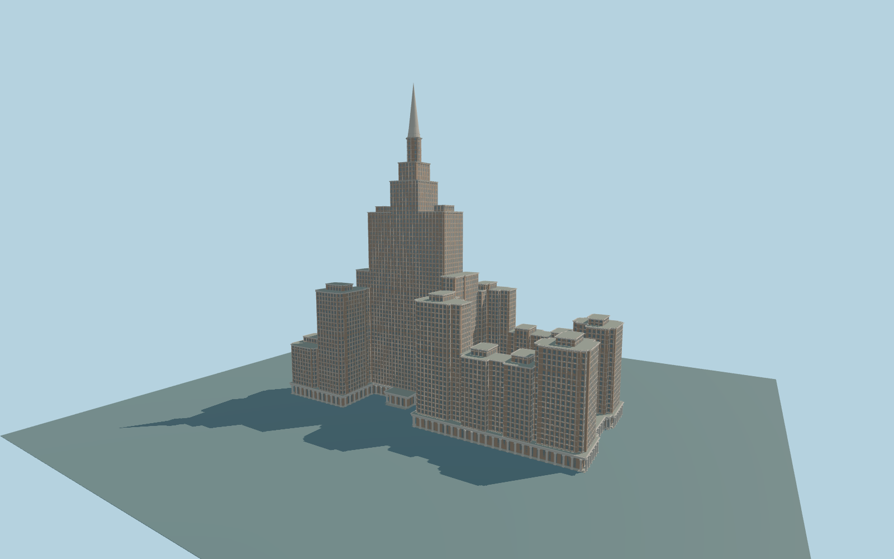

# Triumph Palace

Complete stepped Moscow residential complex:264m central spire and crown,paired tall shoulders,connected lower towers and wings,cream pilasters over warm infill,dark window grids,large roof court,open end court and colonnaded podium with paired porticoes.

Original source:models/triumph-model.mjs,layout.json and attributed map/global-terrain controls. Rebuild with `node packages/worldgen/scripts/generate-triumph-palace.mjs`;append `--check` for exact bytes. Import/LOD commands select `--ids=triumph_palace`. GLBs are ignored outputs.

Five existing shared256px material graphs;no private or embedded images. Detailed master and four browser tiers are separate. Thirty-two retained map parts preserve the whole connected complex,not just the central tower. Near levels keep physical lower colonnades,the10m roof court and open end court. Foundation/stair contact uses an unmodified ordinary viewer terrain field;original ground grades and facade details remain reconstructed. See model-brief.json and qa.json for scope/current acceptance.

Original geometry uses the repository license. Maps:© OpenStreetMap contributors,ODbL-1.0;Protomaps. Raw global terrain hashes/attribution:terrain-grid.json. Linked ordinary pictures are not redistributed or used as textures.
