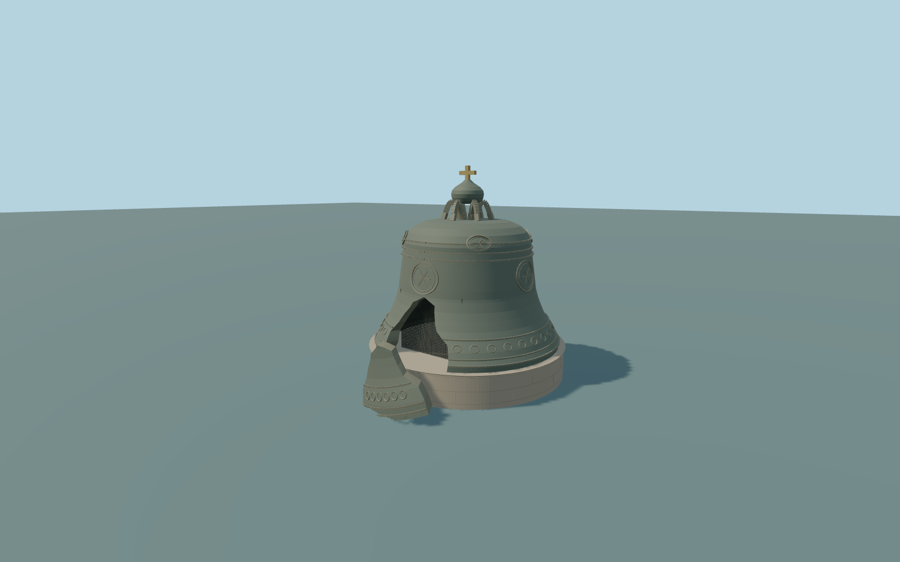

# Tsar Bell

Actual individual broken Tsar Bell anddisplayed fragment:flared thick bronze shell,closed upper shoulder andhollow underside,real missing front wedge withoriginal irregular closed fracture edges,recessed dark safety grille,separate thick curved fragment leaning beside thepedestal,open cast crown handles,onion-shaped cap andplain cross. Raised bands andoriginal abstract oval/rosette/cartouche relief replace portraits,saints andinscriptions. Circular light-stone pedestal andburied support included. Surrounding paving,tower,churches,palaces andall native context remain independent;no navigable interior orcopied artwork.

Rebuild: `node packages/worldgen/scripts/generate-tsar-bell.mjs`;append `--check` for exact source bytes. Select import/LOD/placement with `--ids=tsar_bell`. Detailed source and four browser tiers are separate ignored GLB outputs.

Actual individual broken Tsar Bell anddisplayed fragment:flared thick bronze shell,closed upper shoulder andhollow underside,real missing front wedge withoriginal irregular closed fracture edges,recessed dark safety grille,separate thick curved fragment leaning beside thepedestal,open cast crown handles,onion-shaped cap andplain cross. Raised bands andoriginal abstract oval/rosette/cartouche relief replace portraits,saints andinscriptions. Circular light-stone pedestal andburied support included. Surrounding paving,tower,churches,palaces andall native context remain independent;no navigable interior orcopied artwork.

Retained Wikidata height6.24m isused as above-pedestal monument envelope;source top7.29m above thehost ground withan approximate1.05m pedestal. Bell lipdiameter6.6m,crown proportions,wall thickness,irregular fracture,fragment lean,relief andpedestal areordinary-picture medium-fi proportions,not a casting survey. Usea single host terrain sample atthe named point forY=0;the currentstandard field returns156.46096m. The fixture onlyrebases that unchanged field tozero;no terrain heights areflattened.

Two actually inspected ordinary whole/oblique photographs andcurrentstandard PMTiles. WNW broken-side orientation isapproximate with25-degree uncertainty;the photograph camera/context supplies the sign,not surveyed geometry. Original simplified fracture andabstract ornament arean interpretation,not an exactscan orportrait/text reproduction. Exact pedestal/fragment thresholds,interiors,current safety-grille fitting inventory,physical timings andnumerical LOD errors remainunmeasured.

Three existing shared256px cast-bronze,raw-limestone andpainted-metal graphs,four material groups maximum,metric UVs/linear colors andno private orembedded images. Alltiers preserve theactual broken silhouette,separate fragment,closed shell thickness,pedestal,crown/cap/cross andgrille. Detailed source retains finer curves,lattice andoriginal abstract relief.

Original geometry:repository license. Map:© OpenStreetMap contributors,ODbL-1.0;Protomaps. Standard terrain:terrain-grid.json. Ordinary pictures stay local and are not redistributed or used as textures. Current acceptance:qa.json.
