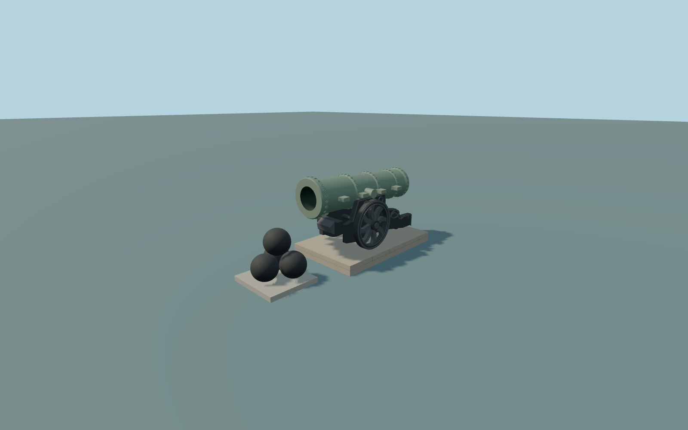

# Tsar Cannon

Complete individual Tsar Cannon display: long patinated bronze barrel with genuinely open deep bore and closed breech, thick ringed muzzle, cast bands, paired trunnions and side lifting lugs. Complete dark cast-metal carriage with both large open-spoked wheels, hubs/axle, paired stepped cheeks and crossmembers, rear trail and small support roller, plus an original faceted front casting and geometric scroll/rosette relief. Low stone platform and four separate displayed cannonballs on their small occupied contact bed. Original abstract geometry replaces portraits, arms, lion faces, inscriptions and plaque text. Surrounding trees, chains/bollards, paths, churches, palaces and all native buildings stay independent; no functioning weapon or navigable interior is asserted.

Rebuild: `node packages/worldgen/scripts/generate-tsar-cannon.mjs`;append `--check` for exact source bytes. Select import/LOD/placement with `--ids=tsar_cannon`. Detailed source and four browser tiers are separate ignored GLB outputs.

Complete individual Tsar Cannon display: long patinated bronze barrel with genuinely open deep bore and closed breech, thick ringed muzzle, cast bands, paired trunnions and side lifting lugs. Complete dark cast-metal carriage with both large open-spoked wheels, hubs/axle, paired stepped cheeks and crossmembers, rear trail and small support roller, plus an original faceted front casting and geometric scroll/rosette relief. Low stone platform and four separate displayed cannonballs on their small occupied contact bed. Original abstract geometry replaces portraits, arms, lion faces, inscriptions and plaque text. Surrounding trees, chains/bollards, paths, churches, palaces and all native buildings stay independent; no functioning weapon or navigable interior is asserted.

Retained Wikidata length5.34m sets the barrel from Z=-2.70 to+2.64. Approximate0.89m bore diameter, outer profile, very slight upward barrel pitch, carriage/wheel proportions, closed internal chamber, original relief,0.36m platform and0.14m ball-contact bed are ordinary-picture medium-fi interpretations, not a casting survey. Both large wheel bottoms and the rear support meet the platform top. A single host terrain sample at the current named point gives common Y=0; standard field144.546875m. The fixture only shifts its vertical reference; raw heights and PNG are unchanged. Native grade varies by about0.30m across the platform.

Two actually inspected ordinary whole-side/front-oblique photographs and the cached current standard PMTiles. East-facing muzzle direction is approximate with25-degree uncertainty. Hidden carriage inventory, internal bore/chamber, wheel ornament, lifting hardware and original geometric relief are simplified; no copied figures, arms, lion portrait, lettering or plaque. The lower ball partly hidden in the photographs is retained in the four-ball display. Exact historic paving, numerical LOD errors and physical-device timings remain unmeasured.

Three existing shared256px cast-bronze,painted-metal andraw-limestone graphs,three material groups maximum,metric UVs/linear colors andzero private orembedded images. Alltiers preserve theopen bore/closed breech,both genuinely open wheels,full carriage/rear support,low platform andfour separate balls. Detailed source retains finer curves,hardware andoriginal abstract cast relief. Nominal LOD allowances are not measured numerical surface errors.

Original geometry:repository license. Map:© OpenStreetMap contributors,ODbL-1.0;Protomaps. Standard terrain:terrain-grid.json. Ordinary pictures stay local and are not redistributed or used as textures. Current acceptance:qa.json.
