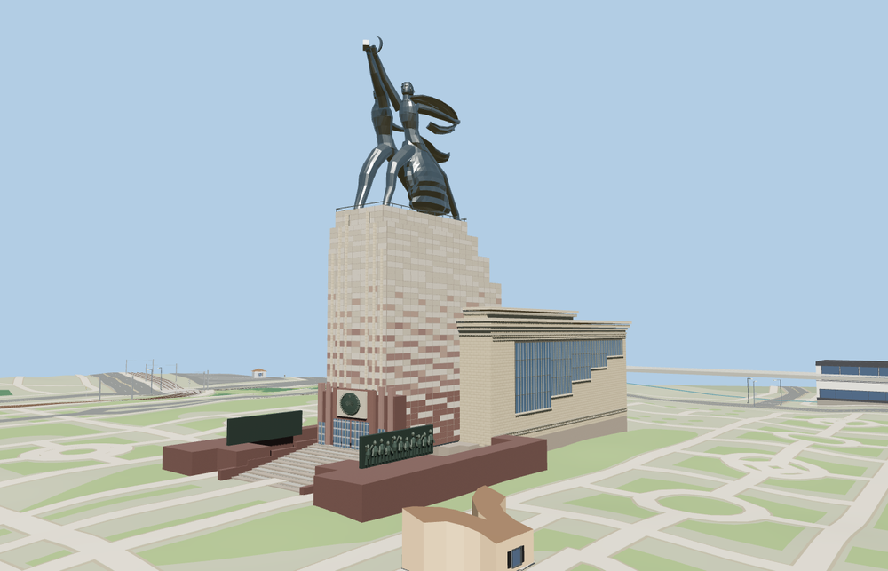

# Worker and Kolkhoz Woman

The 24.5 m stainless-steel group strides southeast above the present VDNH exhibition pavilion. The model includes the raised hammer and sickle, looping scarf, stepped glazing, central stair and bronze reliefs. [Sculpture scale and material](https://en.russia.ru/news/direkciia-vystavki-podelilas-interesnimi-faktami-o-skulpture-rabocii-i-kolxoznica)

Three mapped building parts define the pavilion footprint. Their aggregate envelope is a fourth PMTiles feature for the same building. The signed pavilion axis sets the southeast-facing stride. The standard Terrarium terrain fit uses a 142 m datum. The pedestal height and relief details are estimated from photographs.

The native viewer replaces exactly those four footprint features and retains 12 nearby building features and 216 roads. The surrounding terrain, water and land cover survive model eviction. The load failure case retains the four map footprints.

The 24,974-triangle source master rebuilds from the model recipe. The skyline and district GLBs total 427,276 bytes. Six GLBs passed validation. The native and portable reviews covered 38 views.
