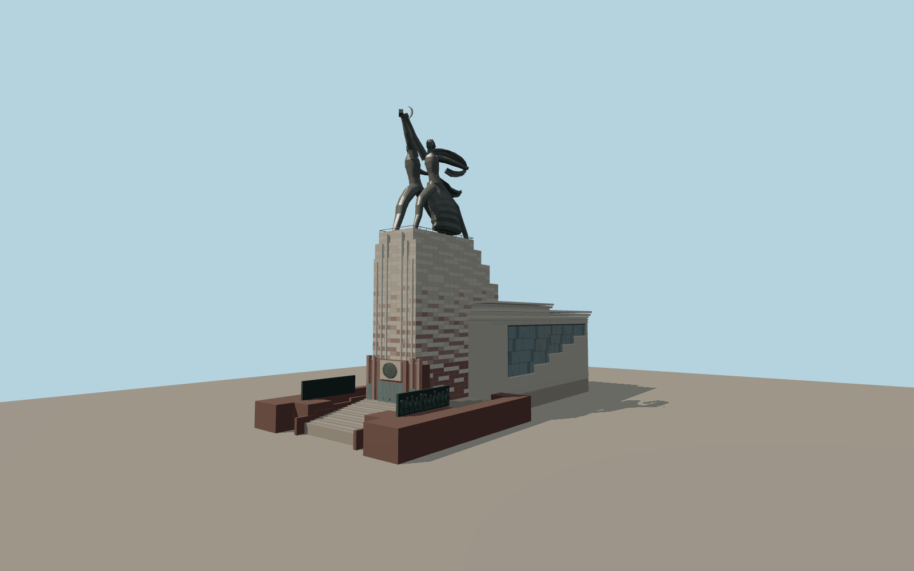

# Worker and Kolkhoz Woman

Two stainless-steel figures stride forward with a hammer and crescent sickle overhead. The swept scarf and skirt carry the same forward pose into the present exhibition pavilion, with its stepped cornices, tiered glazing, rose granite, central stair and bronze reliefs.

Run `node packages/worldgen/scripts/generate-worker-and-kolkhoz-woman.mjs` to rebuild the source master. Append `--check` to compare the exact bytes. Use `--ids=worker_and_kolkhoz_woman` for targeted import, LOD generation and placement.

The three PMTiles building parts, their matching building envelope and the named monument fix the footprint, center and signed axis. Standard Terrarium supplies the site datum.

The figure group is modeled at the published height of 24.5 m. The pedestal elevation, stepped cornices, face proportions, scarf profile, bronze relief compositions and individual panels are reconstructed from photographs.

The exhibition galleries are exterior shells. Relief portraits, coat-of-arms details and sheet-metal seam placement are simplified.

Original geometry follows the repository license. Map data is © OpenStreetMap contributors under ODbL-1.0 via Protomaps. Terrain samples are described in terrain-grid.json. Ordinary pictures stay local and are not redistributed or used as textures. Current acceptance is recorded in qa.json.
