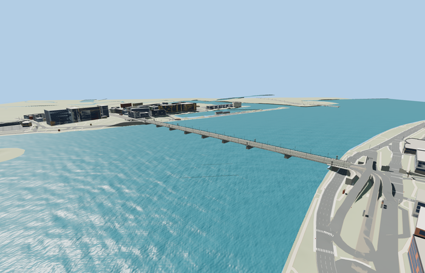

# Akmens Bridge

Reviewed2026-10-29. **Complete medium-fi static exterior and approximate native placement.**

Inspected66 current frames:10 portable,9 shared-material stage,26 medium-fi/context/LOD and21 native PMTiles views. Complete low beam-bridge exterior: granite-faced piers, dark haunched girders with stiffeners/bearings, pale fascia, crowned roadway and both raised sidewalks, twin tram tracks, iron railings with solid ornament plaques, eight seven-globe torch fixtures, modern curved streetlights and catenary. Actual rays verify open water spans, continuous deck/walks, seven distinct globes on every detailed fixture and genuine open railing cells beside solid panels. Coarser tiers aggregate girders, stiffeners, rails, lamp profiles and wires while retaining the long low silhouette.

Four existing shared256px graphs: stone_granite for piers/pilasters and paving,stone_limestone_raw for pale fascia,metal_painted for girders/railings/poles and concrete_plain for road. Metric UV repeats and linear sRGB-derived vertex tints. Two local opaque globe/marking materials; no private or embedded images. Granite texture plus source course seams approximates block masonry. Globes remain static daylight geometry. The four graphs load once; model and approach-support geometry dispose.

| Level | Triangles | Bytes | Draws |
| --- | ---: | ---: | ---: |
| skyline | 704 | 58104 | 1 |
| district | 3968 | 351312 | 6 |
| street | 12548 | 1077304 | 6 |
| closeup | 60080 | 5593652 | 6 |

Detailed source 214156 triangles,25702380bytes. Browser triangles 704 / 3968 / 12548 / 60080,bytes 58104 / 351312 / 1077304 / 5593652,draws 1 / 6 / 6 / 6. Initial skyline+district 409416bytes. All four meet1000/4000/16000/64000triangles and at most6draws,with separate GPU position/normal streams. Detailed master retains eight longitudinal girders,dense stiffeners/diaphragms,masonry seams,cast lamp profiles/scrolls and raised railing ornaments. Browser close-up keeps four girders,coarser stiffeners,planar motif badges and texture-led masonry. No physical laptop/phone timing claim.

Exact-QID way170091344 provides mapped521.983m by34.486m envelope including flared end platforms; core width approximately27m. Published503.12m length is retained as a distinct catalog fact. Road/walk geometry extends524m for bank seam overlap. Current PMTiles main crossing35184377084000,tram35184894933680 and distinct walkway records establish fit. Anchor[24.101202266,56.944660601],heading0.732835788672: +X northeast/Old Riga,-X southwest/Pardaugava,+Z southeast/upstream,-Z northwest/downstream. Native water-relative origin5.151400089263916m follows the standard viewer water plane; this is not surveyed sea level. Internal torch stations nearX-137 and99 follow mapped side bulges; support stations,haunches,sections,vertical grades and ornament remain photo/map approximations.

All five loaded tiers preserve577 building records,the independent road records,the original1146 raw transportation inputs,rawDEM,ground mesh and water. The bounded crossing/connected approach replacement reduces1146to1123 rendered road records. Six outside-end roadway/tram-width samples stay within0.031371m of the authored end datum across every tier. Small rectangular end allowances fix the earlier skewed-vector tram seam. Other raw roads may remain beneath the visible bridge or have different sidewalk/rail paving lifts. The separate Railway Bridge records remain independent; no replacement or resurvey claim for that structure. Coarse shore heights and generated approach supports create steep terraces at both banks; exact embankment/underpass geometry and the surrounding road system remain outside this bridge asset. Failed model loading retains all1146 roads and native ground/water. Unloading releases all model/support geometry and restores the unmodified viewer inputs.

## Reconstruction limits

- Original static medium-fi exterior from ordinary photographs and standard PMTiles. Exact-QID mapped envelope is521.983m by34.486m including wider end platforms; the core bridge is approximately27m wide. The503.12m catalog length remains distinct. Source road/sidewalks extend to524m to overlap coarse mapped bank seams; this is an explicit fit allowance, not a measured structural length.
- Granite-faced intermediate piers, dark haunched steel girders, vertical stiffeners and bearings, pale fascia, complete crowned roadway, two tram tracks, sidewalks, open iron railing cells with solid ornament panels, eight seven-globe fixtures and modern streetlight/catenary poles are modeled. Intermediate support stations, underside sections, pier batter, vertical profiles and ornate motifs are photo/map reconstructions, not surveyed/engineering measurements. The two internal torch stations follow mapped side bulges nearX-137 and99m.
- Detailed master preserves eight longitudinal girders, dense stiffeners and transverse diaphragms, fully modeled cast lamp profiles/scrolls, individual globe/post shapes, raised three-dimensional railing ornaments and masonry course seams. Close-up uses four girders, coarser stiffeners, planar motif badges and texture-led masonry. Street/district aggregate rail cells, supports, lamps and wires; skyline keeps deck, piers and torch-pilaster silhouette.
- Four existing shared256px graphs: stone_granite,stone_limestone_raw,metal_painted and concrete_plain with metric UVs and linear vertex tints; local opaque globe and marking materials. No new/private/embedded images. Granite grain plus modeled courses approximates block masonry; concrete grain approximates road surfacing. Globes are static daytime opaque glass; no night-light/traffic simulation.
- Native placement uses the standard viewer water plane from current PMTiles/Mapzen, not surveyed sea level. Raw river terrain/water and neighboring records are retained. Coarse shore heights and generated road/rail approach supports can produce steep terraces; bank retaining works, ramps, historic buildings and the separate Railway Bridge are outside this asset. Current physical device timings remain unmeasured.
- Bank road-replacement outline includes a small rectangular seam allowance at both ends, to cover coarse vector segmentation. This replaces only the crossing and connected approaches; independent bank roads remain. Model road/sidewalk overlap covers these seams; support grades outside the bridge remain approximate.
- Current hash-bound acceptance is in qa.json and placement-report.json. Native-fit.json and integration-review.json preserve source-promotion controls; their pending text is historical. This is a static exterior and scoped approximate map fit, not engineering dimensions, traffic legality or accessibility verification. Native bulk captures remain local.
