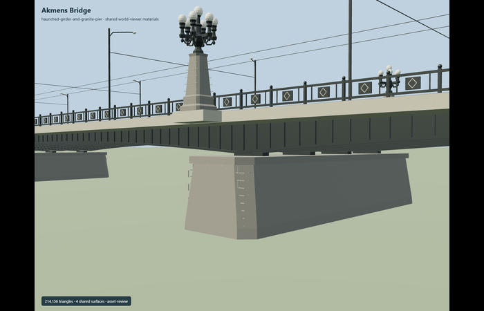

# Akmens Bridge

Granite-pier bridge with dark haunched steel girders, broad roadway and twin tram tracks, stepped sidewalks, iron panel railings and eight distinctive seven-globe torch fixtures; curved modern streetlights and catenary.

Editable geometry lives in models/; model-brief.json records the material library, four authored runtime levels, reference pictures and reconstruction limits. The detailed master is reproducible from this editable recipe; inspection and readiness decisions are recorded separately. All GLBs are ignored generated outputs.

Regenerate with `node content/worldgen/source/places/ud/ud1/akmens_tilts/models/generate-akmens.mjs --ids=akmens_tilts`. Append `--check` to verify exact reconstruction. Import with `node packages/worldgen/scripts/import-structure-models.mjs --ids=akmens_tilts`, then generate runtime levels with `node packages/tooling/scripts/generate-landmark-lods.mjs --ids=akmens_tilts`.

## Review status

Current completion decisions are in qa.json and QA-REVIEW.md when present; the readiness catalog is authoritative. integration-review.json retains the earlier source-promotion checkpoint, including its original pending work. placement-draft.json preserves the proposed orientation, datum and bounded replacement rules. A source build alone grants no visual or geographic approval.

Original geometry uses the repository license. Map-derived controls: © OpenStreetMap contributors, ODbL-1.0. Reference photos retain their own rights and are not model textures.
