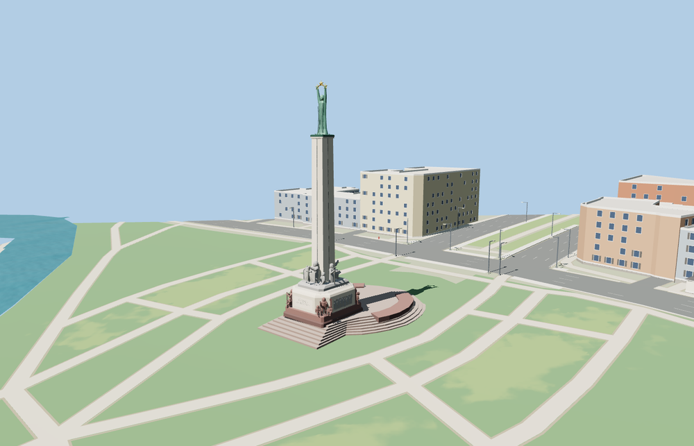

# Freedom Monument

Freedom Monument in Riga with its circular granite terraces, carved side panels, stone figures, tapered travertine shaft, and copper Liberty holding three gilded stars.

The 39,480-triangle source rebuilds byte for byte. Skyline, district, street and close-up use 964, 3,894, 12,742, 35,564 triangles. The first two tiers total 442,192 bytes. Six GLBs validated and 38 current views were inspected.

Each tier passes seven raised-terrace, eight apron, two curved-wall and three star probes. The center star reaches 42 m above the site datum. The viewer replaces the ten mapped monument records and preserves 15 independent buildings, 158 road and path records, and the original terrain, water and land cover. Failed loading restores the mapped monument shell.

The map anchors the apron, shaft, curved walls and boulevard axis. Sculpture proportions and most vertical details come from ordinary photographs and the sculpture plan. The figure poses, carving depths and smaller relief details are exterior reconstructions. The surrounding boulevard, park, canal and buildings remain in the host map. Physical-device timings are unmeasured.

Rebuild with `node packages/worldgen/scripts/generate-freedom-monument.mjs`. Append `--check` to compare exact bytes. Use `--ids=freedom_monument` for targeted import, LOD, placement and readiness.
