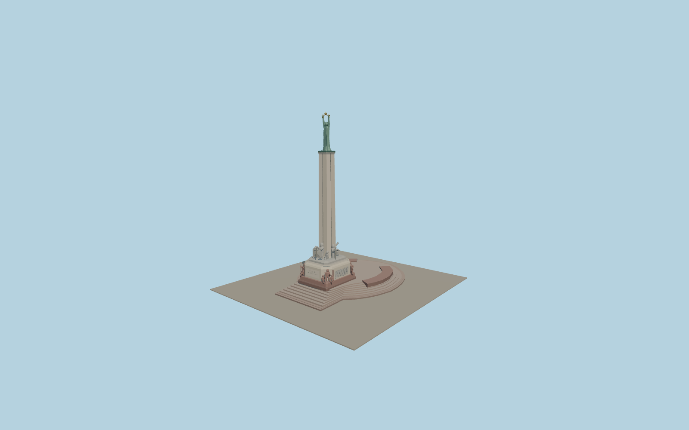

# Freedom Monument

Freedom Monument in Riga with its circular granite terraces, carved side panels, stone figures, tapered travertine shaft, and copper Liberty holding three gilded stars.

Run `node packages/worldgen/scripts/generate-freedom-monument.mjs` to rebuild the source master. Append `--check` to compare the exact bytes. Use `--ids=freedom_monument` for targeted import, LOD generation and placement.

The map anchors the apron, shaft, curved walls and boulevard axis. Sculpture proportions and most vertical details come from ordinary photographs and the sculpture plan.

The figure poses, carving depths and smaller relief details are exterior reconstructions. The surrounding boulevard, park, canal and buildings remain in the host map.

Original geometry follows the repository license. Map data is © OpenStreetMap contributors under ODbL-1.0 via Protomaps. Terrain samples are described in terrain-grid.json. Ordinary pictures stay local and are not redistributed or used as textures. Current acceptance is recorded in qa.json.
