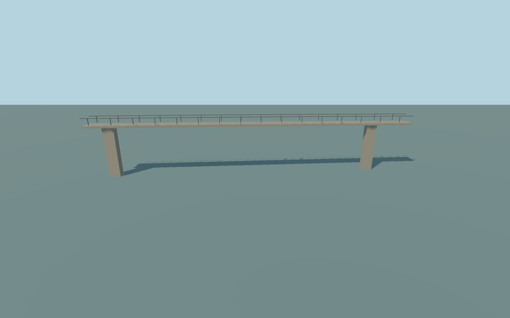

# Island Bridge — right-bank railway viaduct — southeast footbridge

Island Bridge — right-bank railway viaduct — southeast footbridge. Independent pedestrian bridge following its saved PMTiles centerline and real staggered endpoints, with a complete slab, open handrails and supporting columns.

Rebuild: `node packages/worldgen/scripts/generate-island-bridge.mjs`;append `--check` for exact source bytes. Select import/LOD/placement with `--ids=island_bridge`. Detailed source and four browser tiers are separate ignored GLB outputs.

Ordinary-photo medium-fi exterior approximation. Span stations, deck heights, concealed bearing/foundation sections and modern renovation details are estimates; current standard map geometry controls position and extent.

The complete through-route inventory and current native placement are reviewed in qa.json and the parent assembly report; source geometry alone does not establish readiness.

No photograph textures, readable graffiti or signage, downloaded meshes, interiors, traffic or engineering-clearance certification. Physical laptop/phone timings remain unmeasured.

Original geometry:repository license. Map:© OpenStreetMap contributors,ODbL-1.0;Protomaps. Standard terrain:terrain-grid.json. Ordinary pictures stay local and are not redistributed or used as textures. Current acceptance:qa.json.
