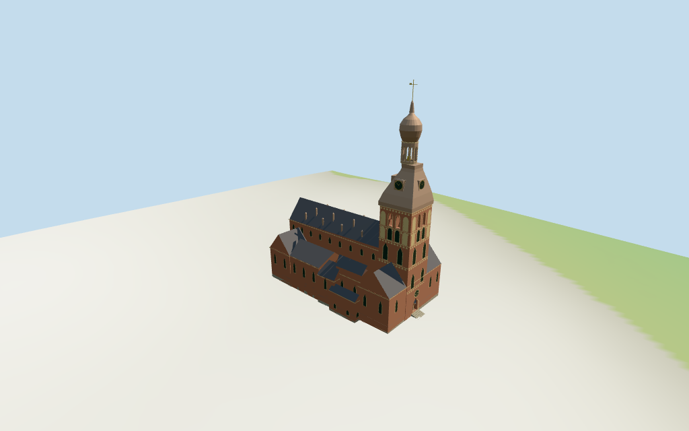

# Riga Cathedral

Individual Riga cathedral exterior: arcaded brick western shaft, brown copper clock roof/open lantern/bulb cap, long gray nave/aisle/transept roofs, lower eastern choir/apses/ranges, mapped roof dormers, circular west window, closed portal and approximate steps.

## Evidence and reconstruction

Published dimensions and reconstructed details are separated in spec.json. Primary references:

- [Reference](https://doms.lv/en/pages/47)
- [Reference](https://et.wikipedia.org/wiki/Riia_toomkirik)

Seven existing shared 256-square brick/limestone/slate/copper/raw-stone/bronze/wood graphs, metric UVs and linear tints. Glass uses vertex colors; no embedded images.

## Model and axes

16,157 triangles; 48,471 vertices; 8 material groups; 1,943,516 bytes. Native bounds: -47.000, -0.584, -22.557 to 43.871, 91.600, 22.592. Source hash: `sha256:6d1deff8e275df3c631217c70be1cdc4680bd0590e9ba793bdc24c198e18a391`.

{"x":"east along nave from western tower","y":"up","z":"south across aisles"}

Individual cathedral exterior from two useful pictures and standard viewer PMTiles/DEM. NativeY0 follows14.348894m standardDEM;1.6m estimated floor clears coarse perimeter−0.23..1.07m. Foundation/plaza/doorstep joins remain approximate; no surveyed floors or certified pedestrian collision.

## Reproduce

Run `node packages/worldgen/scripts/generate-additional-landmarks.mjs --ids=N0334` (or add `--check`). The generator preserves manually edited masters by checking their baseline hashes. Import through the standard authored-model workflow with optimization disabled; then capture all QA cameras, including shared-surface views.

## Pending work

- Retained90m overall height controls the crown. Current PMTiles nominal nave35m, aisles21m, transept/western shoulders23m, lower choir8m/apse5m, small apses12m and roof features31/34m are retained. Tower61/79/83m components guide lower cap/bulb/mast crowns;45m brick eave, lantern split, curved profiles and all intermediate dimensions are picture-led estimates. Low eastern tags are unverified nominal controls.
- Individual cathedral exterior from two useful pictures and standard viewer PMTiles/DEM. NativeY0 follows14.348894m standardDEM;1.6m estimated floor clears coarse perimeter−0.23..1.07m. Foundation/plaza/doorstep joins remain approximate; no surveyed floors or certified pedestrian collision.
- Exact brick tracery, blind arcade patterns, clock numerals, sculpture/weathercock shape, full interiors and surrounding cloister/museum block excluded. Western door design is an estimate; closed portal and simplified vane do not certify walking surfaces. Low eastern5/8m tags are retained without survey verification. Physical laptop/phone timing pending.
- Skyline simplifies closed stages/window surfaces and omits roof dormers; district restores selected belfry/lantern cuts and shared textures; street restores full large cuts, mapped dormers and clock/rose detail; closeup refines bulb/arch facets, friezes and trim. Detail/profile changes remain visible.

This bundle follows the medium-fi standard. Medium-fi appearance and geographic fit are reviewed separately. Hash-bound visual acceptance is recorded separately after capture inspection.

## Additional geographic data

©OpenStreetMap contributors; Protomaps; Mapzen/USGS terrain tiles.
