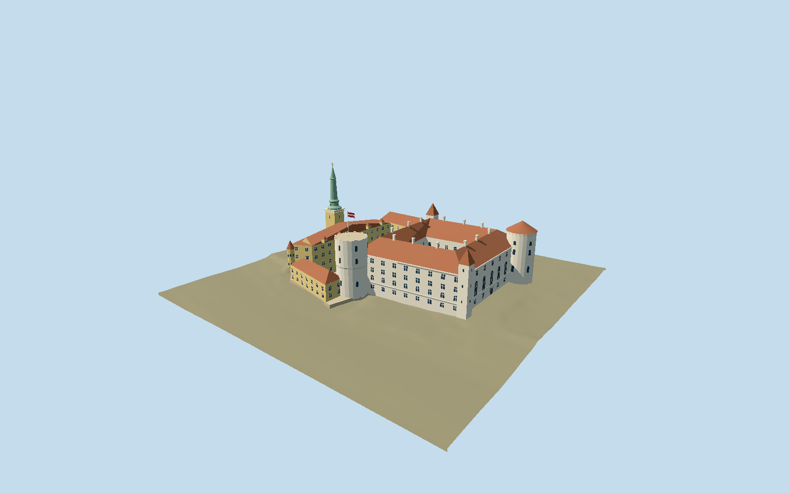

# Riga Castle

Two-court Riga Castle with the white medieval quadrangle, flat-crowned Holy Spirit tower and flag, shallow conical Lead Tower, two square stair towers, yellow presidential ranges, small Erker and copper Three Stars steeple.

## Evidence and reconstruction

Published dimensions and reconstructed details are separated in spec.json. Primary references:

- [Reference](https://www.president.lv/en/riga-castle)
- [Reference](https://lnvm.gov.lv/en/riga-castle/history-of-riga-castle/)
- [Reference](https://sudraba-arhitektura.lv/riga-castle/)
- [Reference](https://www.openstreetmap.org/relation/1393926)
- [Reference](https://hesihe-journals.rtu.lv/iav/article/download/IAV.2025.008/154/323)

No third-party geometry, photograph or bitmap texture is embedded. Shared surface graphs come from the central library; vertex tints carry model colors. Glazing uses PBR materials; transparent surfaces are declared per model.

## Model and axes

7,019 triangles; 19,433 vertices; 6 material groups; 787,444 bytes. Native bounds: -59.373, -2.155, -45.150 to 59.550, 57.756, 44.905. Source hash: `sha256:2fdb02d01f856543f3bcc29381d9fa05dd0b619083a9336e3bbb5ca0f6f3013a`.

{"up":"+Y","longitudinal":"+X southeast152.457143 degrees","front":"+Z southwest242.457143 degrees toward Daugava","origin":"Mapped compound; Y0 retained LAS fitting datum4.3147m LAS2000.5."}

Fresh relation1393926 v36/Q322183 preserves the compound and two courtyard holes within0.000688m rounding. Anchor[24.10056334,56.950966917], heading-1.090082784479: +X southeast152.457143 degrees and +Z southwest242.457143 degrees toward Daugava. Diagonal Holy Spirit/Lead towers and the castle's Three Stars spire sign the frame; neighboring church spires are excluded. Two official LGIA LAS tiles supply82330 retained classified ground points, EPSG3059/LAS2000.5. Two-meter binned fitting ground has a maximum nearest occupied-cell gap16.3831m, principally under buildings. Working datum4.3147m, medieval court2.1141m, forecourt1.0059m, medieval architecture shift0.3141m, bounded foundation-2.1548m. Dataset creation2016 predates current restoration; acquisition date, current alterations, drawing absolute datum and exact entrance connections remain unverified. Diagnostic ground covers168m square. No terrain cutout or single-footprint replacement.

## Reproduce

Run `node packages/worldgen/scripts/generate-signature-towers.mjs --ids=riga_castle` (or add `--check`). The generator preserves manually edited masters by checking their baseline hashes. Import through the standard authored-model workflow with optimization disabled; then capture all QA cameras, including shared-surface views.

## Pending work

- Original6891-triangle/767300-byte source reproduces at sha256:9e20d1fb890f4351f7c932cd0e3f86ddd27c5c8936ad7bc1a6404ee5151a1096 from unchanged riga-castle-model.mjs#buildRigaRuntime and unchanged map-frame.geometry.
- Fresh relation1393926 v36/Q322183 preserves the compound and two courtyard holes within0.000688m rounding. Anchor[24.10056334,56.950966917], heading-1.090082784479: +X southeast152.457143 degrees and +Z southwest242.457143 degrees toward Daugava. Diagonal Holy Spirit/Lead towers and the castle's Three Stars spire sign the frame; neighboring church spires are excluded. Two official LGIA LAS tiles supply82330 retained classified ground points, EPSG3059/LAS2000.5. Two-meter binned fitting ground has a maximum nearest occupied-cell gap16.3831m, principally under buildings. Working datum4.3147m, medieval court2.1141m, forecourt1.0059m, medieval architecture shift0.3141m, bounded foundation-2.1548m. Dataset creation2016 predates current restoration; acquisition date, current alterations, drawing absolute datum and exact entrance connections remain unverified. Diagnostic ground covers168m square. No terrain cutout or single-footprint replacement.
- Ground dataset predates recent restoration: LAS file creation2016 is not a verified flight date. Current ground alterations and exact entrance levels remain unverified.
- Two-meter bins and fitting grid are not surveyed positional accuracy. Empty building footprints are interpolated; retained nearest-cell gap statistics expose coverage limits.
- Bounded buried foundation and separately fitted courtyard levels are reconstruction aids. Drawing datum, door levels, internal passages and forecourt connection are approximate. No terrain cutout.
- Diagnostic ground is confined to168m square. Surrounding city, river, retaining walls, vegetation and garden details are not reconstructed.
- Accepted reconstructed exterior compound: four-wing medieval castellum, roofless paired courts, flat-crowned Holy Spirit with static flag, shallow conical Lead roof, two square stair towers, yellow presidential ranges, small Erker and copper Three Stars spire. Official older aerial and actual museum2024 entrance tour are distinguished from architect design plans/elevations.
- Actual museum panorama confirms exposed restored south masonry; that face uses shared limestone as a stylized substitute for mixed rubble/brick. The design-state opaque glass gallery is retained only in the original master and omitted from the present-day viewer derivative. Museum occupies one restored wing; completion of the entire restoration is not claimed.
- Other castle walls, tower heights/positions, spire, crowns, windows, courtyard gable, chimneys, roof rhythm, entrance panels and floor datums remain reconstructed. Exterior arcade/door panels are closed shallow reserves; no navigable rooms or internal passages. No exact2026 condition survey. Adjacent churches, city, river walls, gardens and vegetation are excluded.
- Four reusable graphs supply lime plaster, limestone, ceramic tile and copper. Local opaque PBR supplies glass, trim and geometric flag/finial colors. Skyline bakes actual common linear means; no embedded images or per-model photographic textures. Physical laptop/phone timings and continuous-motion shimmer pending.

This bundle follows the medium-fi standard. Medium-fi appearance and geographic fit are reviewed separately. Hash-bound visual acceptance is recorded separately after capture inspection.

## Additional geographic data

Footprints © OpenStreetMap contributors, ODbL-1.0. Architectural drawings and official photographs are linked research references, not redistributed images or textures.
