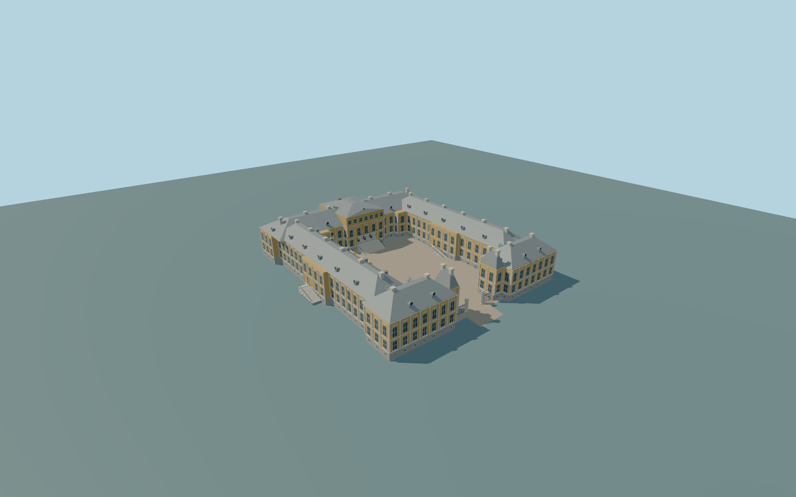

# Rundāle Palace

Complete individual U-shaped principal Rundāle Palace, including rear range, two long side wings, both returned front wings, one open court/gate gap, attached raised center attic/pediment, hipped sheet-metal roofs with round dormers/large chimneys, raised entrances/central and side court stairs and paired gate posts/grilles. Independent curved outbuildings, gardens and access roads remain context.

Rebuild: `node packages/worldgen/scripts/generate-rundale-palace.mjs`;append `--check` for exact source bytes. Select import/LOD/placement with `--ids=rundale_palace`. Detailed source and four browser tiers are separate ignored GLB outputs.

Complete individual U-shaped principal Rundāle Palace, including rear range, two long side wings, both returned front wings, one open court/gate gap, attached raised center attic/pediment, hipped sheet-metal roofs with round dormers/large chimneys, raised entrances/central and side court stairs and paired gate posts/grilles. Independent curved outbuildings, gardens and access roads remain context.

Author a real U-shaped exterior/open court from the union ofthree actual parent fragments;no invented fourth front wall. Raised center entry must have real recessed closed doors and supported stairs. Reusable common material graphs,linear colors/metricUVs;preserve a source master andfour browser tiers. Allfour additional mapped stairflights andseven closed side/garden doors are included;principal entrance has real3m recess/three closed doors. Gate ramp follows the original global terrain at its outer edge.

Original picture-guided relative heights on an approximate23m reference from two unmodified standard viewer Terrariumtiles. Court paving23.8m,raised first-floor entrances26.4m,eave37.5m andcentral attic roof44.6m are visualization levels,not surveyed measurements. Fine ornament/inventories and historic grades remain approximate.

Original approximation of window/dormer/chimney inventories,ornament andhidden elevations. No copied arms,inscriptions,flag graphics ordecorative statuary. Interiors,gardens andindependent outbuildings excluded. Standard terrain isapproximate;historic thresholds/grades andphysical device timing unmeasured.

Six existing256px plaster,limestone,granite,painted-metal,window-grid andpainted-wood graphs;metricUVs/linearcolors. Skyline preserves U-shaped wholepalace/open northgap,attic,coarse stairs andgate/ramp;principal closed-door recess iscoarsened. District adds sparse glazing. Street adds facade rhythm/dormers/chimneys;closeup adds window rims,details andgate bars. Master retains dense frames/profiles. Error estimates3/1.5/.7/.25m are unmeasured approximations;physical timing unmeasured.

Original geometry:repository license. Map:© OpenStreetMap contributors,ODbL-1.0;Protomaps. Standard terrain:terrain-grid.json. Ordinary pictures stay local and are not redistributed or used as textures. Current acceptance:qa.json.
