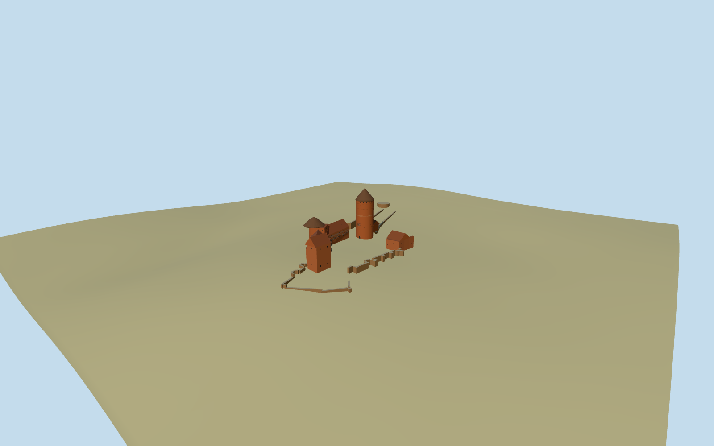

# Turaida Castle

Restored brick castle on the Gauja ridge with round Bergfried, tiled roofs, timber galleries and surviving enclosure walls.

Authoring state: **review-in-qa.json**. Current completion evidence is in [qa.json](qa.json) and the [completion ledger](../../../../qualla-structures/batches/qualla-003.PROGRESS.md).

- [Turaida Castle](https://qualla.com/turaida-castle/)

The restored masonry and surviving enclosure are modeled in the standing condition photographed in 2023. Small archaeological remains and museum fixtures are outside scope.

The Bergfried’s published measurements and the principal outlines govern the exterior. Secondary roof and curtain heights, the open gallery framing and small fenestration are estimated.

The terrain is unmodified provider elevation on the ridge. Individual courtyard paving profiles and small changes at the foot of each wall are approximate.

Build: `node content/worldgen/source/places/ud/ud1/turaida_castle/models/generate-turaida-castle.mjs`. Add `--check` to verify exact regeneration. 7989 triangles; 5 materials; no embedded photographs.
