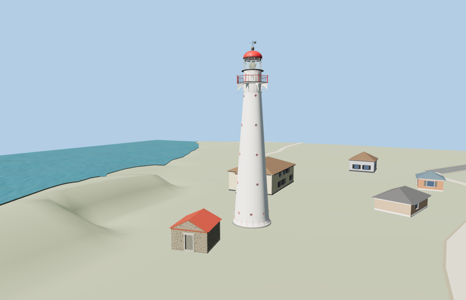

# Kihnu Lighthouse

Reviewed 2026-11-14. The tower and its stone oil store render together on the south coast of Kihnu. The registered position and 28.3 m above-base height follow national aid 840. The oil store’s mapped position southwest of the tower establishes the signed orientation. The north entrance is a reconstruction from the landward approach. [National navigational aid register](https://nma.transpordiamet.ee/aton/2849/) · [Mapped plan](map-frame.json)

## Placement

The standard viewer terrain sets the base at the tower center. The oil-store walls stand 0.14 m above that origin, and foundations extend below the sampled grade at both buildings. The viewer replaces the two matched PMTiles footprints and retains four nearby buildings, the paths and the coastline. The failed-load test retains both native footprints, and all four detail levels release their geometry on unload.

## Geometry and materials

The detailed master includes the tapered cast-iron shaft, 24 red-diamond ports, pierced octagonal gallery, red-patterned drum, transparent lantern, optical assembly and riveted red dome. The oil store has recessed openings, stone walls, brick trim and a red metal roof. The street and close-up models preserve all 24 port recesses. Skyline and district simplify glazing and fittings, with a door panel that follows the tapered shaft.

| Level | Triangles | Bytes | Draws |
| --- | ---: | ---: | ---: |
| skyline | 930 | 71,600 | 1 |
| district | 3,946 | 299,964 | 7 |
| street | 13,095 | 1,020,220 | 8 |
| closeup | 38,447 | 3,248,864 | 8 |

Six shared material graphs supply painted metal, concrete, stone, brick, granite and wood. All six GLBs passed Khronos validation with zero embedded images. The skyline and district files total 371,564 bytes. Three targeted tests and 67 inspected renders cover geometry, materials, terrain fit, lighting and detail transitions. [Review data](qa.json)

The finer architecture and local elevations are reconstructed from ordinary photographs and standard viewer maps. The optical assembly is a visual representation. Device-specific frame rates remain unmeasured. [Authority photograph](https://nma.transpordiamet.ee/view_file/2377) · [Lantern reference](https://toolbox.estonia.ee/asset-page/256622-kihnu-lighthouse)
