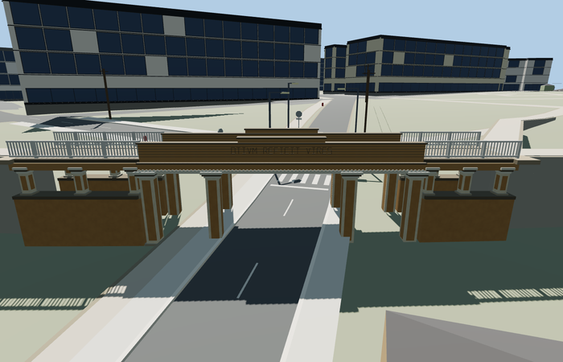

# Inglisild / Angel’s Bridge, Tartu

Reviewed 2026-10-27. **Scoped medium-fi exterior and approximate native placement complete.**

Inspected 62 current frames: 11 portable, 11 shared-material/geographic, 23 medium-fi and 17 native. The mustard-and-white classical bridge retains eight tall framed square piers around three lower bays, twelve shorter wing piers, asymmetric mapped wings, open white rails, timber frieze, dentils, circular ornaments, raised central panel and a simplified shallow bronze profile. Corrected the reverse-face motto so it reads from outside, and widened the northwest landing cap to cover the mapped turning path in this same authoring pass. Source and current near models are complete for the scoped medium-fi exterior.

Four existing shared 256px graphs: stucco, wood_plain, stone_limestone_raw and metal_painted. Metric UVs and linear vertex tints; no embedded/private images or copied photograph pixels. Near levels use four merged groups; skyline uses a single mean-tinted group. Each graph is fetched once per native view and runtime files use separate GPU attribute streams.

| Level | Triangles | Bytes | Draws |
| --- | ---: | ---: | ---: |
| skyline | 600 | 55428 | 1 |
| district | 3328 | 304212 | 4 |
| street | 8804 | 787784 | 4 |
| closeup | 9932 | 887000 | 4 |

Master: 10676 triangles / 1284040 bytes. Runtime levels: 600 / 3328 / 8804 / 9932 triangles, 55428 / 304212 / 787784 / 887000 bytes and 1 / 4 / 4 / 4 draws. Initial skyline plus district 359640 bytes. Strict medium-fi budgets pass; physical-device timing remains unmeasured.

Named PMTiles bridge footway 35184405327539 and Angel’s Bridge POI 17592517490936 establish the original Inglisild/Q12364556 identity; no exact-QID footprint claimed. Anchor [26.717632704376012,58.37959986270152], heading -0.9482293478071121, is refined to the independent Lossi crossing. +X southeast, -X northwest; +Z southwest/uphill toward Toome Hill, -Z northeast/downhill toward central Tartu. Unequal mapped endpoints [-14.615345420985541,0] / [16.794144088365687,0] retain the 31.40949m transport length. Width 4.6m and source datum 64.6m/floor 70.35m are explicit visual approximations. Nine actual mapped boundary width samples have support and retained paving at every LOD; maximum model/paving difference 0.00600433349609375m. Three lower-road probes retain at least 4.039500618940323m below the conservative beam datum; renderer-fit results, not surveyed legal clearance.

All 630 resident buildings, 890 input roads and 830 independent road records remain. Four separate Lossi road records receive zero authored connections; upper footpaths alone are deliberately graded. Raw DEM, rendered ground and water remain unchanged. Failed loading preserves the map crossing; unload releases all model/support geometry. No ground cutout was used.

## Reconstruction limits

- Scoped classical bridge exterior only. Named PMTiles footway length 31.40949m and its unequal bank wings locate the model; the 4.6m width, pier spacing, ornament and vertical sections are visual approximations. No exact-QID bridge polygon or surveyed section is claimed.
- Source datum 64.6m and floor 70.35m give clearance above the coarse standard Lossi road. Mapzen smooths the local cut and hill; connected upper footpaths are deliberately graded with bounded supports. Exact hill embankments, stairways and park landscaping are not reconstructed.
- The bronze profile is an original shallow geometric abstraction of the photographed Parrot medallion, not a precise portrait likeness. Fine dedication/date lettering is omitted; the opposite Latin motto uses simple original stroke geometry. Exact carpentry and cast ornament are simplified.
- Mustard timber, cream frames, white open rails and pale foundations use existing shared 256px material graphs with metric UVs and linear tints. Distant levels simplify pier moldings, rails, seams, portrait and text; physical phone/laptop timing is unmeasured.
- Coarse native hill geometry does not reproduce the historic cut, exact bank slopes, retaining walls or stairs. Upper paths use the current renderer’s bounded grade/support adaptation. Procedural streets, poles and neighboring buildings are retained context; physical-device performance remains unmeasured.
- Fine Greek-key railing borders and complete dedication/date lettering are simplified or omitted. The portrait is an original low-relief abstraction, not a precise likeness.
