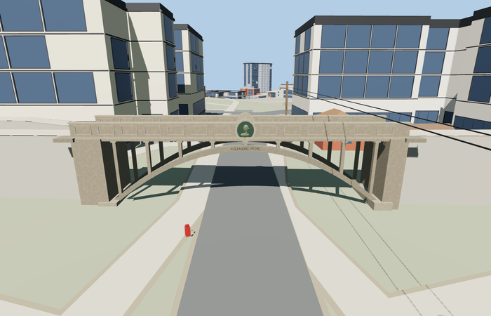

# Kuradisild / Devil’s Bridge, Tartu

Reviewed 2026-10-27. **Scoped medium-fi exterior and approximate native placement complete.**

Inspected 63 current frames: 11 portable, 11 shared-material/geographic, 23 medium-fi and 18 native. One open road span has paired exposed concrete arch ribs, slender open-spandrel posts, complete deck/caps, solid paneled parapets, raised oval portrait halo, outward-readable ALEXANDRO PRIMO caption, opposite 1613/1913 date wreath and two small under-deck lights. Corrected post-to-faceted-arch contacts at every LOD, attached lettering/leaves to their backing, and replaced the initial timber-like boardformed graph with existing plain concrete in this same authoring pass. Both Tartu bridges retain distinct geometry and locations in the paired native fixture.

Two existing shared 256px graphs: concrete_plain and metal_bronze_cast. Three semantic material groups near and one mean-tinted group at skyline. Metric UVs and linear vertex tints; no embedded/private images or copied photograph pixels. Six unique graphs across the two bridges are each fetched once in near native views; only the companion’s four graphs load for skyline or target failure. Runtime files use four separate GPU attribute streams.

| Level | Triangles | Bytes | Draws |
| --- | ---: | ---: | ---: |
| skyline | 612 | 54204 | 1 |
| district | 3652 | 302968 | 3 |
| street | 5304 | 448076 | 3 |
| closeup | 6204 | 518856 | 3 |

Master: 7784 triangles / 936560 bytes. Runtime levels: 612 / 3652 / 5304 / 6204 triangles, 54204 / 302968 / 448076 / 518856 bytes and 1 / 3 / 3 / 3 draws. Initial skyline plus district 357172 bytes. Strict medium-fi budgets pass; physical-device timings remain unmeasured.

Named PMTiles bridge footway 35184425968185 and Devil’s Bridge POI 17592516087228 establish original Kuradisild/Q12367783; no exact-QID footprint claimed. Anchor [26.715899572445203,58.37894049389129], heading -0.4926250291239677, is refined to the separate Lossi road crossing. +X east-southeast, -X west-northwest; +Z south-southwest/uphill, -Z north-northeast/downhill. Unequal endpoints [-12.487462442700435,0] / [11.676002584774675,0] retain the 24.163465m transport length. Width 4m, source datum 71.1m/floor 76.85m and sections are photo/standard-terrain approximations. All 18 mapped width samples have model support; 12 retain native paving and join within 0.003997802734602374m. Six samples are inside the replacement and are not called pavement joins. Fifteen actual upward raycasts at three road stations and five width offsets retain at least 3.6277746128079826m below the rendered geometry across four LODs. These are renderer-fit results, not surveyed/legal clearance.

All 523 resident buildings and 605 independent road records remain. There are 678 raw road records; legitimate bridge clipping produces 680 output records with both models loaded, or 679 when Kuradisild fails and Inglisild remains. Only the shared upper path and the two mapped bridge paths receive deliberate adaptation. Four separate lower Lossi records retain their inputs and receive zero authored connections. Raw roads, DEM, displayed ground and water remain unchanged. Target failure preserves its mapped crossing and the real companion landmark; unload releases all model/support geometry. No ground or building cutout is used.

## Reconstruction limits

- Scoped bridge exterior: one clear road opening, paired visible outer arch ribs and open spandrels. Named bridge footway retains 24.163465m transport extent and unequal banks; 4.0m width, rib/column sections and height are photo/standard-terrain visual approximations. No exact-QID footprint or surveyed section claimed.
- Source datum 71.1m and floor 76.85m fit the coarse native Lossi road approximately. Mapzen smooths the road cut and hill; upper footpaths are deliberately graded with bounded supports. Exact slopes, historic stairs, retaining walls and park trees remain outside the asset.
- The Alexander portrait is an original shallow geometric abstraction, not a precise likeness. The opposite dated wreath, rectangular panel frames and Latin arch caption retain distinctive shapes; exact leaf carving, casting and inscriptions are simplified.
- Existing shared 256px concrete_plain and metal_bronze_cast graphs provide metric repeated surfaces and linear tints. No embedded/private textures or copied photo pixels. Distant levels simplify curves, posts, panel frames, portrait and date lettering. Physical-device timings remain unmeasured.
- The standard coarse hill does not reconstruct the historic road cut, retaining walls, park trees or exact stairs/banks. Shared renderer approach grading is approximate visual support. Procedural neighboring buildings/streets/poles remain context. The portrait is an original geometric abstraction; exact casting, leaf carving and complete inscriptions are simplified. Physical laptop and phone performance remains unmeasured.
