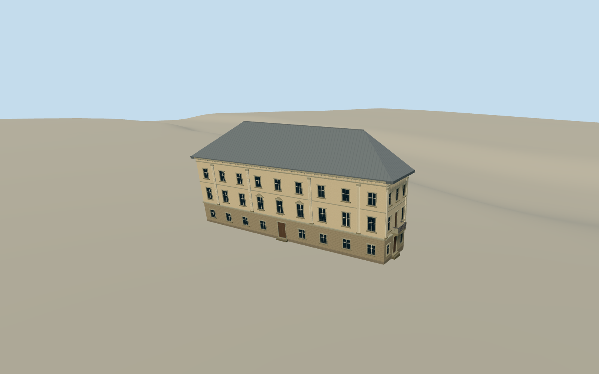

# Tartu Art Museum

The three-storey Leaning House of Tartu at Raekoja plats 18, with its documented lean, classical façades and square-facing balcony.

Authoring state: **review-in-qa.json**. Current completion evidence is in [qa.json](qa.json) and the [completion ledger](../../../../qualla-structures/batches/qualla-003.PROGRESS.md).

- [Tartu Art Museum](https://qualla.com/tartu-art-museum/)

The museum documents a 5.8° lean. The architectural account identifies the Kompanii side as the settled side. The exterior uses a uniform shear toward that side and approximates the variation in settlement.

The mapped footprint is exact to the source vector precision. The façade opening census and positions, eaves, ridge, balcony metalwork and current finishes are estimates based on the written architectural description and building data.

The model covers the museum building itself, excluding the neighboring 1877 bank, cellar interior, and former stables and coach house.

Build: `node content/worldgen/source/places/ud/ud7/tartu_art_museum/models/generate-tartu-art-museum.mjs`. Add `--check` to verify exact regeneration. 7578 triangles; 7 materials; no embedded photographs.
