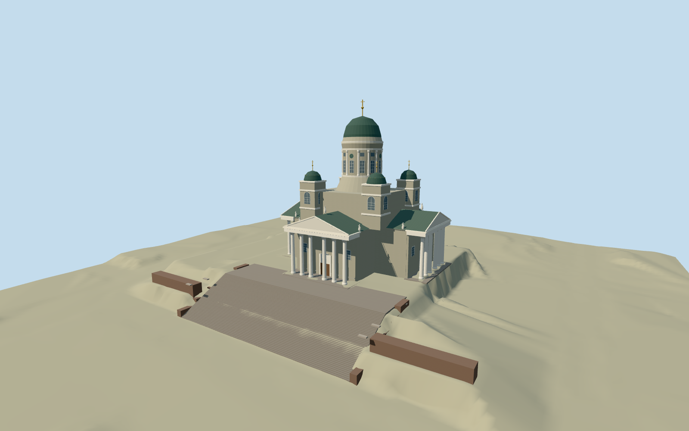

# Helsinki Cathedral

The white Empire cathedral above Helsinki Senate Square, with four porticoes, five green domes and its monumental granite stair.

Authoring state: **review-in-qa.json**. Current completion evidence is in [qa.json](qa.json) and the [completion ledger](../../../../qualla-structures/batches/qualla-004.PROGRESS.md).

- [Helsinki Cathedral](https://qualla.com/helsinki-cathedral/)

Fine zinc statuary, roof ornament, and portions of the stone terrace beyond the cathedral are simplified.

Build: `node content/worldgen/source/places/ud/ud9/helsinki_cathedral/models/generate-helsinki-cathedral.mjs`. Add `--check` to verify exact regeneration. 15070 triangles; 5 materials; no embedded photographs.
