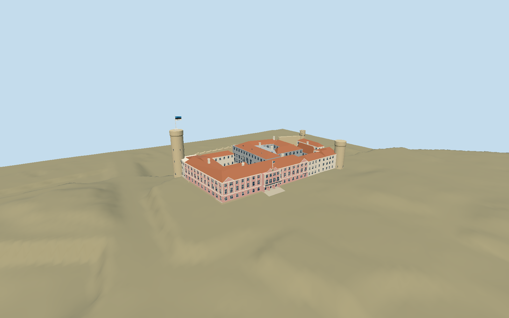

# Toompea Castle

Mapped Toompea compound with pink east and south palace fronts, Baroque central gable, open courts, grey Riigikogu building, limestone western wall, Tall Hermann flag tower, Landskrone and console-mounted Pilsticker.

## Evidence and reconstruction

Published dimensions and reconstructed details are separated in spec.json. Primary references:

- [Reference](https://www.riigikogu.ee/en/visit-us/toompea-castle/toompea-castle-riigikogu-building/)
- [Reference](https://www.riigikogu.ee/en/visit-us/toompea-castle/tall-hermann-toompea-towers/)
- [Reference](https://www.riigikogu.ee/en/visit-us/photos-castle-riigikogu/)
- [Reference](https://www.openstreetmap.org/relation/3502552)
- [Reference](https://www.openstreetmap.org/relation/3502550)

No third-party geometry, photograph or bitmap texture is embedded. Shared surface graphs come from the central library; vertex tints carry model colors. Glazing uses PBR materials; transparent surfaces are declared per model.

## Model and axes

9,851 triangles; 27,249 vertices; 5 material groups; 1,102,340 bytes. Native bounds: -70.249, -11.836, -42.310 to 70.304, 51.116, 48.243. Source hash: `sha256:2d41b6dd9758f80ae903f38b58f2ab483663aa363f4cc35d2c829b3de6b7f92a`.

{"up":"+Y","longitudinal":"+X north-northwest353.441315 degrees","front":"+Z east-northeast83.441315 degrees toward Castle Square","origin":"Signed mapped compound; Y0 retained DTM43.8842m EH2000 working datum."}

Fresh relation3502552 v22/Q859010 and27 saved mapped components retain source plan within0.000688m rounded vertex difference. Anchor[24.737375127,59.435763956], heading1.685266971193793: +X north-northwest353.441315 degrees and +Z east-northeast83.441315 degrees toward Castle Square. Tall Hermann southwest, Pilsticker northwest and Landskrone northeast sign the frame; source east-porch plane aligns with entrance node8004030808, while individual arch centers remain approximate. Public Estonian sheet63843 Float32 DTM EPSG3301 has native1m cells and129²4m diagnostic samples, working EH2000 datum43.8842m. Court floor0.8497m and buried foundation-11.8363m are bounded fitting levels. Northern mapped blocks are raised to local corner maxima; exterior tower bases meet retained ground. Tall Hermann uses approximate published stone-crown83m and flag-top95m above sea, preserving the mapped45.6m shaft and12m mast; independent geoid comparison to EH2000 remains unverified. Foundation covers the bounded compound; surrounding cliff/gardens remain host ground. No terrain cutout; not a single footprint replacement.

## Reproduce

Run `node packages/worldgen/scripts/generate-signature-towers.mjs --ids=N0263` (or add `--check`). The generator preserves manually edited masters by checking their baseline hashes. Import through the standard authored-model workflow with optimization disabled; then capture all QA cameras, including shared-surface views.

## Pending work

- Original9769-triangle/1092484-byte master reproduces at sha256:e447957fc4808006037199c1e31d5dcafb394480cc946882444190bc61cac70a from unchanged toompea-castle-model.mjs#buildToompeaRuntime and unchanged map-frame.geometry/parts.
- Fresh relation3502552 v22/Q859010 and27 saved mapped components retain source plan within0.000688m rounded vertex difference. Anchor[24.737375127,59.435763956], heading1.685266971193793: +X north-northwest353.441315 degrees and +Z east-northeast83.441315 degrees toward Castle Square. Tall Hermann southwest, Pilsticker northwest and Landskrone northeast sign the frame; source east-porch plane aligns with entrance node8004030808, while individual arch centers remain approximate. Public Estonian sheet63843 Float32 DTM EPSG3301 has native1m cells and129²4m diagnostic samples, working EH2000 datum43.8842m. Court floor0.8497m and buried foundation-11.8363m are bounded fitting levels. Northern mapped blocks are raised to local corner maxima; exterior tower bases meet retained ground. Tall Hermann uses approximate published stone-crown83m and flag-top95m above sea, preserving the mapped45.6m shaft and12m mast; independent geoid comparison to EH2000 remains unverified. Foundation covers the bounded compound; surrounding cliff/gardens remain host ground. No terrain cutout; not a single footprint replacement.
- One-meter native cells resampled to four-meter diagnostic ground; cell size is not surveyed positional accuracy. Latest DTM spans2021–2024; exact local acquisition date unverified.
- Castle floors, roof/eave heights and northern block datums are fitting approximations. Buried bounded foundation is not a copied surveyed cliff mesh. No terrain cutout.
- Operator gives Tall Hermann stone crown83m and flag top95m above sea; derivative uses these approximate absolute controls, preserving45.6m mapped shaft and12m mast. The datum conversion to EH2000 and detailed corbels are unverified.
- DTM crop is original public ground data; no meshes or photographic textures downloaded. Surrounding gardens, cathedral and town remain excluded.
- Accepted reconstructed present-day exterior: pink east/south palace, curved central and triangular end pediments, three external porch arches, grey four-wing parliament and roofless courts, west limestone curtain, Tall Hermann flag/corbel crown, console-mounted Pilsticker and Landskrone. Palace and parliament porches have actual open approaches backed by closed facade/door reserves; no through-building route or interiors promised. Demolished Stür den Kerl is absent.
- Roof/eave heights, arches, window rhythm, north passage, state arms, corbels, triangular ornament and low-office roofs remain photographic approximations. No exact2026 daily-condition survey. Cathedral, surrounding houses, trees, gardens and furniture are excluded. Static flags; no wind dynamics.
- Three reusable graphs provide limestone, lime plaster and ceramic tile. Local opaque PBR supplies glass, trim and geometric flag colors. Skyline bakes actual common linear means; no embedded images or per-model photographic textures. Physical laptop/phone timings and continuous-motion shimmer remain pending.

This bundle follows the medium-fi standard. Medium-fi appearance and geographic fit are reviewed separately. Hash-bound visual acceptance is recorded separately after capture inspection.

## Additional geographic data

Footprints © OpenStreetMap contributors, ODbL-1.0. Riigikogu photographs are linked visual evidence, not redistributed textures or geometry.
