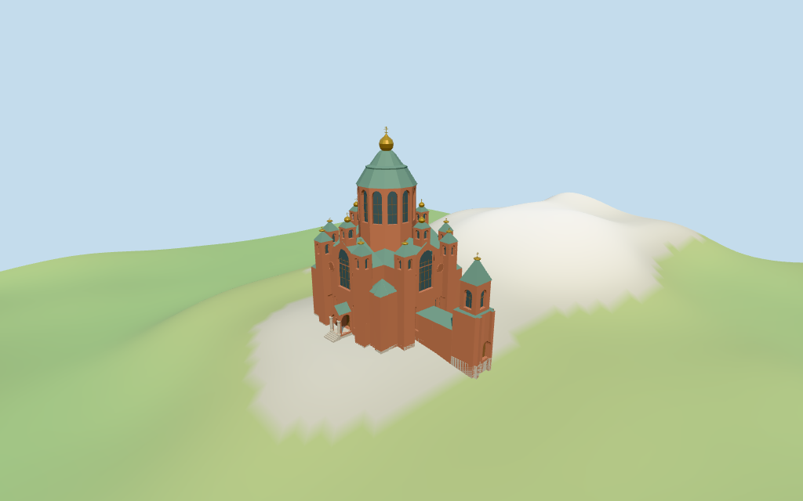

# Uspenski Cathedral

Individual Uspenski Cathedral, Helsinki: red-brick cross-shaped upper church, round east apses, stepped low corner/side roofs, tall polygonal brick drum with round-arched glazing, tiered green copper helmet and gold onion/cross; four medium roof turrets, eight smaller corner pyramids/gold tips, lower southern bell/vestibule tower and link, and projecting western gabled open porch with grey granite columns and wood entrance. Shared brick/granite/copper/wood, linear tints, metric UVs, flat architectural normals and four browser levels. Standard terrain foundations. Exact ornamental brick/sculpture/inscriptions, glass artwork, hidden roofs and room plans, neighboring buildings, surveyed hill/plaza grading and certified walking excluded.

## Evidence and reconstruction

Published dimensions and reconstructed details are separated in spec.json. Primary references:

- [Reference](https://commons.wikimedia.org/wiki/File:Front_of_Uspenski_Cathedral_In_Helsinki.jpg)
- [Reference](https://commons.wikimedia.org/wiki/File:Uspenski_Cathedral_from_above_-_2510.jpg)
- [Reference](https://commons.wikimedia.org/wiki/File:Uspenski_Cathedral_2022.jpg)

Four existing cached256-square brick, granite, copper and plain wood graphs. Linear brick/green copper tints, metric UVs and flat architectural normals. Gold caps/crosses and closed glazing use geometric PBR colors. No embedded images, bespoke facade maps or baked shadows.

## Model and axes

27,987 triangles; 83,961 vertices; 6 material groups; 3,362,072 bytes. Native bounds: -20.437, -2.605, -22.038 to 16.782, 44.400, 21.905. Source hash: `sha256:80f9b66982151fcf81cbbbd12441f5374e45dc9bb292fdb3bc4fda98668ed535`.

{"x":"east along cross arm from western entry to round apses","y":"up","z":"south toward lower bell/vestibule tower"}

Standard viewer DEM datum 33.868569m; display floor0.4m, mapped perimeter terrain -2.26..0.45m. Side footings follow coarse viewer terrain. Raised main west porch/wood threshold and south low tower steps are visual estimates, not surveyed joins. Exact hill rock/plaza grading, cut-fill, ramps/steps/thresholds, absolute altitude and walking remain unverified. No global flattening or road replacement.

## Reproduce

Run `node packages/worldgen/scripts/generate-additional-landmarks.mjs --ids=N0372` (or add `--check`). The generator preserves manually edited masters by checking their baseline hashes. Import through the standard authored-model workflow with optimization disabled; then capture all QA cameras, including shared-surface views.

## Pending work

- Exact-QID way15242921/Q1355001 matches main35184387331753. All52 current controls retain raw plans/tags: main,50 church parts and separate layer1 western porch35185635043709. Main height is absent; all min_height values remain absent. Heights are whole envelopes, not stacked solids: central core23m, drum/copper helmet39m and tip44m; arms21m; four medium roof turrets25m with27m tips; eight smaller shafts/copper pyramids22m with23m tips; corner roofs14.7m; main apse16m/side apses8.8m; south link7.7m; low bell base10.4m/upper16.4m/copper cone20.5m/tip22m; west porch7.5m. There is no retained Wikidata height fact. Picture estimates subdivide these into base5.2m, main eaves16.4m/gable ridges21m/core23m, corner eaves12.2m/hips14.7m, apse eaves12m/roofs16m and side eaves6.4m/roofs8.8m, link eaves5.9m/roof7.7m, central drum16.4..31.8m (lower portion intersects roofs; exposed above approximately23m)/copper helmet31.8..39m/gold onion39..42.5m/cross44m. Medium turret brick16.4..24m (lower portion intersects arm roofs)/copper collar25m/gold/cross27m; small masonry shafts from local footings to20m/copper pyramid22m/gold/cross23m. Low bell wall to16.4m/cone20.5m/tip22m; porch eaves5.7m/ridge7.5m. The three low corridor parts meet at one quantized point; their local bounding rectangle joins the low roof, with sub-metre simplification of its stepped edges. Exposed base ledges are capped. Raw controls rotate rigidly without rescale; Boolean inputs round0.1mm. Exact fenestration, hidden roof joins, carvings, brick courses and doorway steps remain picture estimates.
- Standard viewer DEM datum 33.868569m; display floor0.4m, mapped perimeter terrain -2.26..0.45m. Side footings follow coarse viewer terrain. Raised main west porch/wood threshold and south low tower steps are visual estimates, not surveyed joins. Exact hill rock/plaza grading, cut-fill, ramps/steps/thresholds, absolute altitude and walking remain unverified. No global flattening or road replacement.
- Medium-fi exterior from three inspected2019/2022/2025 entrance/exterior pictures and standard viewer PMTiles/DEM only. Flat faceted architecture, stylized brick relief, green copper profiles, gold caps/crosses and geometric closed glazing preserve principal features. Exact ornamental brick/sculpture/inscriptions, stained glass, roof joints/furniture, hidden room/interior plans, surveyed hill/plaza paving/doorway levels and certified walking excluded or approximate. Physical laptop/phone timings pending.
- Skyline keeps mapped massing, high drum/helmet, roof turrets, apses, lower tower and porch. District adds cached surfaces and flat round fields. Street opens wall/porch recesses with closed glazing/wood and coarse mullions/pilasters. Closeup/master refine arch surrounds, columns, gold profiles and crosses. Synthetic cottage context is a review fixture.

This bundle follows the medium-fi standard. Medium-fi appearance and geographic fit are reviewed separately. Hash-bound visual acceptance is recorded separately after capture inspection.

## Additional geographic data

©OpenStreetMap contributors; Protomaps; Mapzen/USGS terrain tiles.
