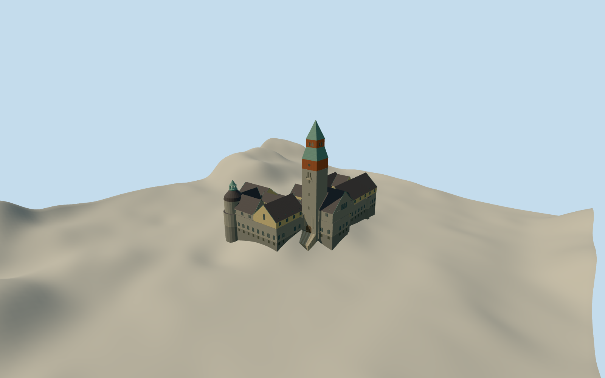

# National Museum of Finland

The Helsinki museum’s irregular granite wings, open courts and 58-meter copper-spired tower in 2012.

Authoring state: **review-in-qa.json**. Current completion evidence is in [qa.json](qa.json) and the [completion ledger](../../../../qualla-structures/batches/qualla-003.PROGRESS.md).

- [National Museum of Finland](https://qualla.com/national-museum-of-finland/)

The original outline, courtyard openings and main entrance are mapped. The historic roof sections, minor turret positions, bay widths and statue relief are proportional estimates informed by the 2012 photographs.

The tower height is based on the museum’s 58-meter published dimension. The source terrain is unchanged. Original provider elevations include likely canopy and roof effects, and local thresholds and foundations are approximate.

The scope is the historic exterior and two courtyards in 2012. The later addition and interior galleries are outside scope.

Build: `node content/worldgen/source/places/ud/ud9/national_museum_of_finland/models/generate-helsinki-museum.mjs`. Add `--check` to verify exact regeneration. 8606 triangles; 6 materials; no embedded photographs.
