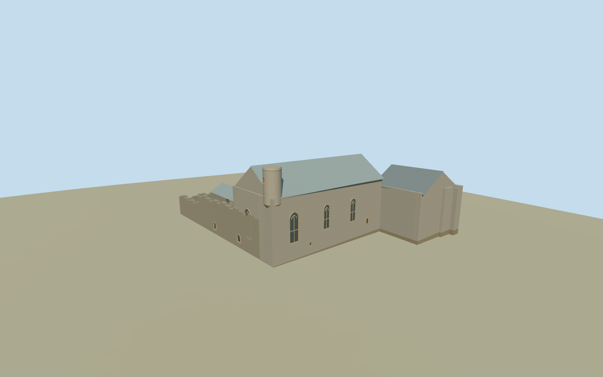

# Padise Abbey

Padise’s conserved limestone abbey with its northern church, surviving corner turret and open walled courtyards.

Authoring state: **review-in-qa.json**. Current completion evidence is in [qa.json](qa.json) and the [completion ledger](../../../../qualla-structures/batches/qualla-004.PROGRESS.md).

- [Padise Abbey](https://qualla.com/padise-abbey/)

The present conservation state is represented by the documented roof additions, open courts and extant walls. Precise wall profiles, the lesser openings and surviving chamber heights are approximated.

Scope follows the mapped abbey enclosure. The separate manor and outlying structures beyond the abbey are excluded.

Build: `node content/worldgen/source/places/ud/ud9/padise_abbey/models/generate-padise-abbey.mjs`. Add `--check` to verify exact regeneration. 6622 triangles; 6 materials; no embedded photographs.
