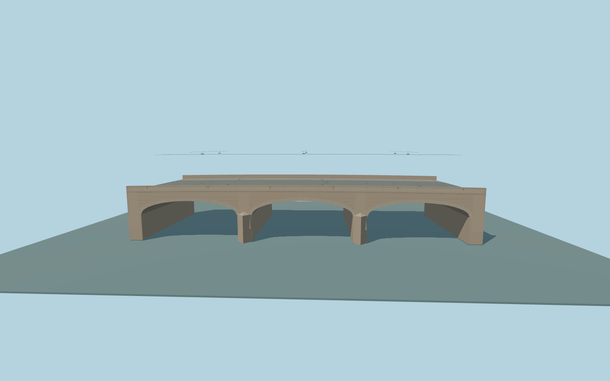

# Pitkäsilta

Complete individual Pitkäsilta bridge body: three shallow granite barrels, two broad piers with angular cutwaters, full mapped57m crossing and22.744m deck, granite spandrel courses and radial arch blocks, capped panel parapets and quiet geometric drop motifs, road, two tram tracks with four rails and crossing contact/suspension wires, six small suspended lamps, outer cycle/walk surfaces and short end bearings. Neighboring quays and bank-mounted wire supports remain native.

Rebuild: `node packages/worldgen/scripts/generate-pitkasilta.mjs`;append `--check` for exact source bytes. Select import/LOD/placement with `--ids=pitkasilta`. Detailed source and four browser tiers are separate ignored GLB outputs.

Fixed21m visualization datum, approximate23m deck ends and23.25m center crown. Standard local water samples 19.048m; actual native water is separately measured in the renderer. The global urban field is biased above physical sea level; these fit controls and buried foundations are ordinary-photo approximations, not surveyed elevations.

Three ordinary photographs and current PMTiles guide this original medium-fi exterior. The75m catalog length is not treated as a uniform75m body: mapped road/tram/cycle bridge endpoints and retained structure agree on57m. Vault rise, granite courses, panel motifs, cutwater details, rail/catenary/light profiles, transport allocations and submerged foundations are approximate. No copied photos, downloaded meshes, graffiti, readable labels, boats, trams or buses. Independent neighboring quay walls, banks, buildings, subway and light/wire poles remain native. Coarse city terrain/water limits are recorded after actual viewer inspection; physical-device timings remain pending.

Original geometry:repository license. Map:© OpenStreetMap contributors,ODbL-1.0;Protomaps. Standard terrain:terrain-grid.json. Ordinary pictures stay local and are not redistributed or used as textures. Current acceptance:qa.json.
