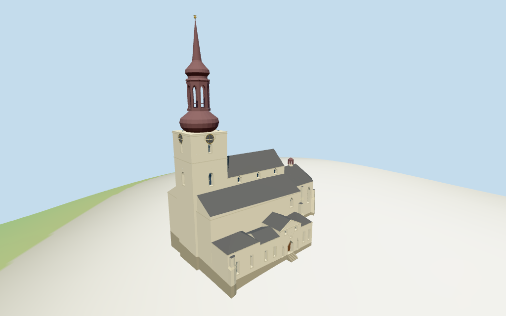

# st_marys_cathedral_tallinn — St. Mary's Cathedral, Tallinn review

Reviewed 2026-10-14 against current source/runtime bytes. Accepted for this medium-fi exterior and approximate geographic/terrain scope.

## Built result

Inspected all 11 final portable/source-terrain views. Individual off-white basilica has a taller clerestory,lower sloping aisle roofs,polygonal eastern choir and minor open roof lantern. Western square clock tower supports a broad lower bulb,open octagonal arched lantern,smaller upper bulb and long taper/finial. Northern chapel/sacristy and connected southern ranges retain their mapped plans;the south entrance has a triangular pediment,closed pointed wood door,flank lancets,paired upper windows and an east hip-roofed bay. Corrected the tiny choir-lantern boolean slivers with actual posts,moved choir openings clear of buttresses,followed skewed map quads in gables,added the missing exposed south aisle window,refined the upper bulb and added an estimated DEM entry transition. Dark northern sacristy roof is present and passes an imported roof ray. Exact text/tracery/sculpture excluded.

Medium-fi exterior from three useful pictures and standard viewer PMTiles/DEM only. Current 37m tower block,43m lower octagonal roof and 69m upper spire tags control the silhouette;the old whole-building 42m tag is retained as a conflicting coarse control. Current 20/28m aisle/clerestory,20m choir,12/11m north rooms and 9..11m southern ranges are interpreted as roof tops. Lower eaves/wall subdivisions,baroque bulb/lantern/cornice profiles,clock fields,windows/doors,annex roof joins,minor choir turret and entry transition are picture-led estimates. Color reflects inspected 2013/2015 ground views and a labeled 2023 aerial still;later restoration appearance is not independently verified. Exact inscriptions,clock numerals,tracery,sculpture and full interiors excluded. Physical device timings and certified walking pending.

## Shared materials and placement

Inspected all 11 final shared-material/geographic views. Five existing 256-square graphs supply lime plaster,raw limestone,standing-seam metal,copper and plain wood. Warm off-white walls,pale frames/stone foundations,gray roofs,brown/burgundy copper spire and restrained gold clocks/finial use linear tints and metric UVs. Blue-gray glazing is flat. Skyline uses graph mean colors. Every graph reads once;unloading disposes geometry,leaves zero live model geometries and restores ground. Flat placement checks the signed current outline;source-terrain renders show coarse hill contact and entry steps. Ground colors are diagnostic.

Retained exact-QID OSM way26902813 matches current numeric main PMTiles feature35184398991645 by the way-ID offset. The current main plus 21 parts preserve raw plans/tags around anchor [24.739166428,59.437057279],heading -0.030561530713rad. Retained undirected axis is signed by western tower,eastern polygonal choir and south entrance in inspected ground/aerial pictures. Current PMTiles does not itself expose wikidata;this uses retained exact-way identity. Source choir union and exposed east-front subtraction match their raw inputs. All 30 actual viewer footprint checks cover the main building and preserve three neighbors/west plaza across six outputs. Standard DEM datum 56.265474m,estimated floor 2.3m and sampled peak 1.911m provide coarse hill contact. The entry steps/ramp are an estimated transition over that DEM,not surveyed historic stairs. Precise street/door thresholds,absolute altitude and certified walking remain unverified. No road replacement.

Inspected all 27 final Earth-lighting views:Economy/High,noon/late,three distances,silhouette,six details,four matched whole-model levels and four transitions. Skyline preserves the basilica/choir/chapel masses,two-bulb western spire,open four-post rectangular lantern,small choir turret and coarse buttresses;entry uses an inclined transition. District adds shared graphs,flat windows/closed doors,clocks/cornices,round-arched octagonal lantern and stepped entry. Street opens real facade recesses and adds sparse mullions/lantern rails. Closeup/master refine curved facets,clock marks,frames and upper lantern ornament. Changes in curvature,openings,entry and ornament remain visible. Matched views show the complete model;detail crops are intentional. Swedish-cottage neighbors are synthetic context,not local map buildings.

## Browser budgets

| Level | Triangles | Bytes | Draws |
| --- | ---: | ---: | ---: |
| skyline | 885 | 94800 | 1 |
| district | 3340 | 332880 | 8 |
| street | 5277 | 518508 | 8 |
| closeup | 7625 | 757956 | 8 |

Initial skyline plus district: **427680 bytes** of geometry. Master: **919728 bytes / 7625 triangles**. Five separately cached shared graphs;zero embedded images. Initial geometry excludes graph definitions/texture generation. Separate POSITION/NORMAL streams have equal CPU/GPU totals. Physical device timings pending.

## Verification

- Targeted byte reproduction:generate-additional-landmarks.mjs --ids=st_marys_cathedral_tallinn --check. Source/import/LOD/review hashes match.
- Six GLBs pass Khronos with zero errors,warnings or embedded images. Four browser budgets pass.
- All 22 raw controls/original height tags,retained exact-way identity,signed frame and standard DEM match. Derived choir union and visible east-front difference match. All outputs retain 69m top above common floor.
- **770 imported geometry probes** pass:principal/room roofs,spire finial,entry support,open primary lantern bays/heads and minor post bay;detailed clear facade/door recesses,closed backing and clear threshold.
- **30 actual viewer footprint checks** pass:main plan covered;three neighboring buildings and west plaza retained across six outputs.
- Five graphs read once;unload disposes geometry/restores ground.
- Source inventory/schema,recipe index,map-frame and medium-fi review bindings pass.
- Scene validation/30-tick simulation pass:sha256:edfd934a5c3803544c20fce0cd10955c1076294b34e113553c70d0c55bfb7c8e.
- Inspected **49 final frames**: 11 portable,11 shared/placement and 27 medium-fi. Reports retain paths/cameras/hashes;bulk captures stay local/ignored.

Source hash:sha256:c842f30e8c65be7ed9978e4712639082a03e347410a3722b1e67f874855ed038. Runtime hash:sha256:7adee34acbce9bb62b72ed75a315589170d28c336d5d5c5f289a6bf833ef8d99. Input hash:sha256:22a90b458f8933ef18ccc980b701c61eec0ed2dce2b1f20481fd6128587d39d9.

Commands:targeted generate/import/LOD;capture-structure-models.mjs --ids=st_marys_cathedral_tallinn --reflections --antialias --fit-shadows;capture-landmark-library.mjs --ids=st_marys_cathedral_tallinn --reflections --adaptive-clipping --bounded-placement;capture-medium-fi.mjs --ids=st_marys_cathedral_tallinn --reflections;molen validate;molen sim run --ticks 30 --hash. No full engine suite/audit or full source rebuild repeated;next routine source checkpoint follows transfiguration_cathedral.

## Limits

- Retained exact-QID OSM way26902813 matches current PMTiles main feature35184398991645 by the documented way-ID offset;21 current church building parts retain their unscaled plans and height tags. Current tower37m,lower octagonal roof43m and upper spire69m control total silhouette;old whole-building42m tag is retained as a conflicting coarse control. Other current20/28m aisle/clerestory,20m choir,12/11m north rooms and9..11m south frontage tags are interpreted as roof tops,with picture-led lower eaves/wall subdivisions. Exact eaves,bulb/lantern/cornice subdivisions and minor choir turret are estimates,not surveyed architecture.
- Standard DEM datum 56.265474m;estimated common floor 2.3m clears sampled compound peak 1.911m and perimeter -3.61..1.29m. Foundations follow coarse hill terrain. Exact street/door thresholds,absolute altitude and certified walking unverified;no independent survey.
- Exterior approximation from three useful ground/aerial pictures and standard PMTiles/DEM. Main/part height tags conflict and do not specify eaves:all lower wall/roof subdivisions,clock cornice,two bulb/lantern profiles,window and annex facade rhythms,minor choir turret, estimated entry steps/ramp over the coarse DEM and exact thresholds are picture-led estimates. Palette reflects inspected 2013/2015 and labeled 2023 images;later roof-restoration appearance is not independently verified. Exact inscriptions,clock numerals,tracery,sculpture and full interiors excluded. Certified walking and physical device timings pending.
- Skyline keeps mapped masses,main two-bulb spire,open four-post rectangular lantern and coarse small roof turret/buttresses. District adds shared graphs,flat windows/closed doors,clocks/cornices and octagonal round-arched lantern. Street opens real facade recesses and adds sparse mullions/lantern rails. Closeup/master refine curved facets,clock marks,frames and upper lantern ornament. Curvature,openings and ornament change visibly. Swedish-cottage neighbors are synthetic context,not local map buildings.

Readiness accepts this exterior scope. The 1,000-candidate goal remains incomplete.
