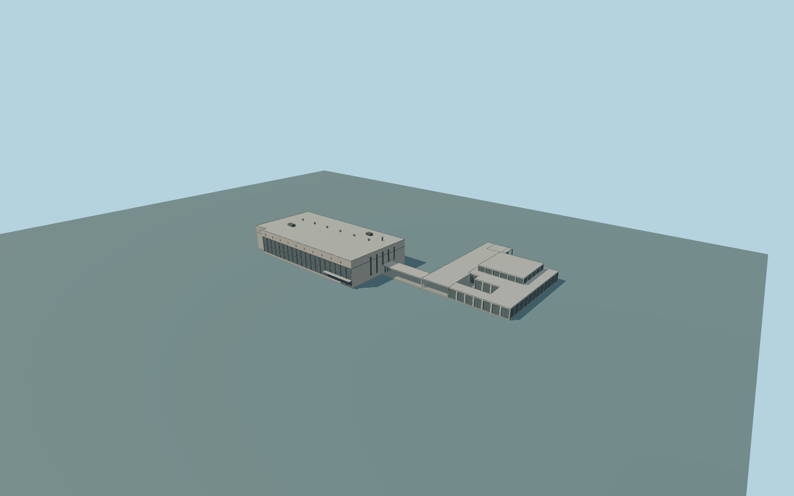

# Tallinn Baltic Station

Complete connected present passenger-building ensemble: main limestone/curtain-wall hall,clock-end facade andtall narrow windows,flat roof/services,attached northeast covered connector withsupports,andthe whole physically linked low pavilion withits5m roof/wall ranges and8m central part. Author closed entrances,roof thickness andcoherent platform/rear returns;preserve outside pedestrian spaces. Corporate/shop lettering,logos,road/tram infrastructure,detached shelter158,independent Go Hotel14/174 andmarket105 remain outside this station-building model. No navigable interior.

Rebuild: `node packages/worldgen/scripts/generate-tallinn-baltic-station.mjs`;append `--check` for exact source bytes. Select import/LOD/placement with `--ids=tallinn_baltic_station`. Detailed source and four browser tiers are separate ignored GLB outputs.

Complete connected present passenger-building ensemble: main limestone/curtain-wall hall,clock-end facade andtall narrow windows,flat roof/services,attached northeast covered connector withsupports,andthe whole physically linked low pavilion withits5m roof/wall ranges and8m central part. Author closed entrances,roof thickness andcoherent platform/rear returns;preserve outside pedestrian spaces. Corporate/shop lettering,logos,road/tram infrastructure,detached shelter158,independent Go Hotel14/174 andmarket105 remain outside this station-building model. No navigable interior.

Native main hall23m height conflicts with ordinary picture proportions and remains recorded. Source main parapet13m,service top15m;connected low pavilion follows native5m roofs and8m core. Picture-derived facade heights,entrance canopy and hidden opening inventory are approximate. One common unchanged host sample at local[-5,22], 20.5649125m suppliesY=0;closed occupied floors+.35m/support-3m. No per-part terrain offsets or artificial outside plaza.

Two ordinary street andclock-end pictures actually inspected. Hidden rear/window inventory and exact heights remain original medium-fi approximations. No more picture or bespoke reference research needed. The connected low pavilion is present in current map geometry;its detailed opening inventory is inferred,not separately established by the two main-hall photographs. Original medium-fi permanent exterior only;no copied brands,lettering,detached street shelter,Go Hotel,market,road/tram infrastructure or navigable interior. Entrance canopy is a shallow wall-bracketed approximation;it adds no artificial ground mask. Exact native contact requires current field review. Physical-device timings and numerical LOD errors remain unmeasured.

Seven existing shared256px limestone,granite,membrane,painted-metal,window-grid,storefront andplain-concrete graphs;seven groups maximum. Metric UVs,linear colors,no private orembedded images. Skyline keeps completehall,clock-end windows,connector andpavilion withopenportico. District addsindividualpanes,roofservices andcoping. Street addsrealrecesses andmetalframes. Close-up addsdoor/transom members,finerclock andservicefittings. Detailed master preservesfinerclock curves separately.

Original geometry:repository license. Map:© OpenStreetMap contributors,ODbL-1.0;Protomaps. Standard terrain:terrain-grid.json. Ordinary pictures stay local and are not redistributed or used as textures. Current acceptance:qa.json.
