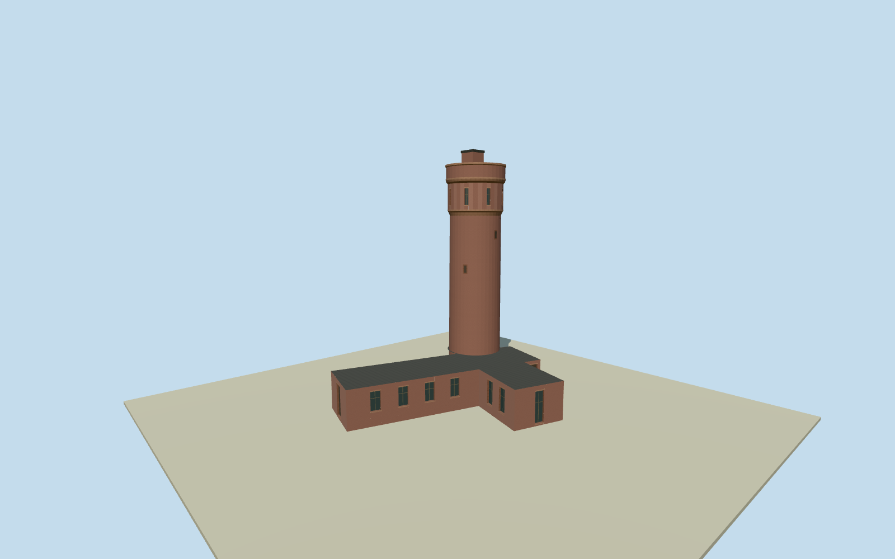

# Pyynikki Observation Tower

The round red-granite observation tower on Pyynikki Ridge, with its upper windows, open viewing deck and attached ground-floor café.

Authoring state: **review-in-qa.json**. Current completion evidence is in [qa.json](qa.json) and the [completion ledger](../../../../qualla-structures/batches/qualla-003.PROGRESS.md).

- [Pyynikki Observation Tower](https://qualla.com/pyynikki-observation-tower/)

The model represents the tower and café in September 2011. The nearby freestanding radio mast and park buildings are outside its scope.

The upper window and skyline details are constrained by the distant cleared photo; the window count and spacing, tower taper, parapet and stair headhouse dimensions are approximations.

The present mapped café outline stands in for its unverified 2011 outline. Its roof construction, elevations, openings and paths are estimates.

Original raster relief shows the general ridge grade; the visual building foundation is not a survey.

Build: `node content/worldgen/source/places/ud/udb/pyynikki_observation_tower/models/generate-pyynikki-observation-tower.mjs`. Add `--check` to verify exact regeneration. 1864 triangles; 4 materials; no embedded photographs.
