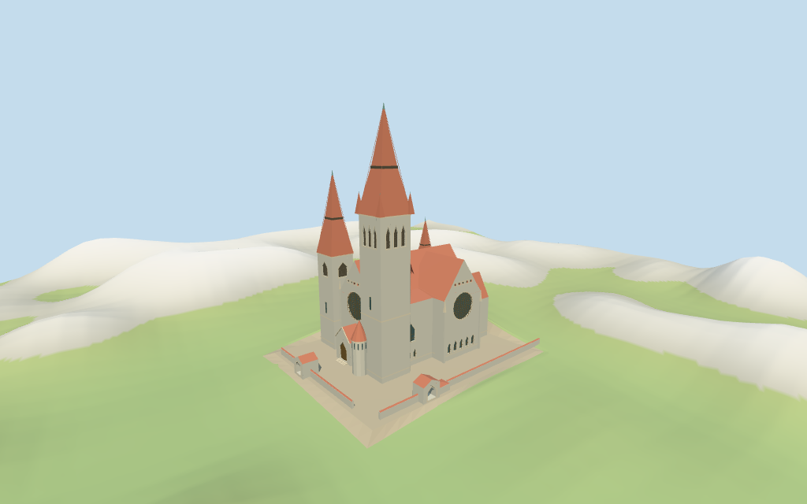

# tampere_cathedral — Tampere Cathedral review

Reviewed 2026-10-16 against current source/runtime bytes. Accepted for the medium-fi exterior and approximate horizontal placement. The 64/68 m height discrepancy, internal roof/stage partitions and exact host-ground joins remain unresolved or approximate.

## Built result

Inspected all 11 final portable/source-terrain frames, including the 1024x640 summary. The individual rough-stone church has west and south rose gables, steep intersecting red tiled roofs, three unequal tapering spires with green tips, triple tall-tower louver panels, smaller pointed louvers, gabled west portal, round stair turret, southeast sacristy and two mapped open pedestrian gatehouses with short red-capped wall wings. Corrected portal depth, unsupported lower-canopy lights, a north light outside its wall, sacristy-window occlusion, hidden short-tower panels and buried tower corner roofs. Hidden roof joins and fine stone/glass details remain approximate.

Medium-fi exterior from three actually inspected photographs: MatteoTRphoto 2017 west front, M62 2007 south oblique and Methem 2012 full main spire, plus standard viewer PMTiles/DEM. No bespoke surveys or redistributed images. Current tower-part height 68 m and retained whole/Wikidata height 64 m conflict and remain explicitly unresolved; the current tower envelope guides this approximation. Other part envelopes 52/36/28/20/5 m are retained with estimated internal stages. Fine stone sculpture, exact masonry courses, glass art, complete enclosure/park/trees, interiors/bells and engineering are excluded or simplified. Hidden roofs, current finish, exact host contact and physical-device performance remain unverified.

## Shared materials and browser levels

Inspected all 11 final shared/geographic frames. Five existing cached 256-square dry-stone, granite, ceramic tile, copper and plain wood graphs serve seven merged groups. The dry-stone pattern approximates the varied granite masonry; exact dressed-block courses are not reproduced. Opaque louver panels use the trim slot to retain their timber tint. Metric UVs, linear colors, flat architectural normals and local blue-gray PBR glazing; no embedded images, private facade maps, photo textures or baked lighting. Every shared graph loads once, unload leaves zero live model geometries and restores the terrain opening. Flat-fixture edge slivers reflect the DEM-fitted apron meeting unmatched flat ground; this is not terrain accuracy approval.

| Level | Triangles | Bytes | Draws |
| --- | ---: | ---: | ---: |
| skyline | 791 | 78,984 | 1 |
| district | 2,403 | 219,820 | 7 |
| street | 5,433 | 482,636 | 7 |
| closeup | 7,269 | 648,868 | 7 |

Initial skyline plus district geometry: **298,804 bytes**. Detailed master: **876,420 bytes / 7,269 triangles**. Runtime: **875,788 bytes**. Five shared 256² graphs; zero embedded images. Geometry download figures exclude graph definitions and runtime texture generation. POSITION/NORMAL streams are separate; CPU/GPU reservations match.

Inspected all 27 final medium-fi frames: Economy/High, noon/late, three distances, texture-free silhouette, six details, four matched whole LODs and four transitions. Skyline 791 triangles retains all three unequal spires, both rose gables, irregular roof, portal/round turret, two gate passages and low wall wings. District 2403 adds shared surfaces, front/side light rhythm and grouped louver/roof bands. Street 5433 adds actual recessed openings, lead-grid abstraction, cornices and buttress caps. Close-up/master 7269 refine lead/louver spacing and sparse roof ribs. Distant grouped panels and omitted small lights are intentional. Regional Finnish log cabins are fixtures. Physical laptop/phone timing remains pending.

## Geographic and terrain review

Retained exact way/88874701 and Q1236638 match current whole **35184460963533** and its same-ID multilingual cathedral POI. All **eight current controls / 60 raw points**, their properties, and the earlier **23 distinct whole points** remain in the source. Anchor **[23.769840877,61.502489582]** and heading **0.150597742317 rad** are unchanged. The west rose/portal and unequal southwest/northwest towers sign −X as the front; +X is east, +Z south. Approximate facing uncertainty is 3°. No horizontal rescale.

Mapped whole/Wikidata height **64 m** disagrees with the current tall tower part **68 m**. Both remain source facts; the model follows the current tower envelope as an approximation. Northwest/northeast tower parts **52/36 m**, body **28 m**, southeast **20 m** and gatehouse **5 m** supply other envelopes. Eaves, internal stages, windows, roofs and the **0.4 m** floor are picture estimates.

The retained church-center DEM sample is **124.958456 m**, above the western approach reference **112.765598 m** at **[23.769207975677983,61.50244375902157]**. Selected-control perimeter samples relative to the latter are **−0.65 to +10.26 m**. An existing viewer **64×53 m reversible ground opening** is covered by the authored Y=0 floor and a perimeter apron fitted to raw DEM samples. Its source preview lowers only the covered patch to emulate the runtime opening. Raw source heights and roads remain unchanged. Actual hide/show/unload restoration passes. This reconstructs the site grade; exact park/gate/door/base joins, host edges, altitude and walking remain unverified.

All **90 actual viewer-footprint checks** cover the eight controls and apron while preserving four neighbors and west/south street regions. Flat shared-fixture edge slivers reflect its mismatch with the DEM-fitted apron. Regional cabins are context fixtures, not a reconstruction of neighboring downtown buildings.

## Verification

**49 final frames inspected**: 11 portable/source-terrain, 11 shared/geographic and 27 medium-fi. **354 actual geometry probes** cover closed roofs, three spire tips, both whole gate passages, covered apron floor and recessed door/glass/louver panels. Six Khronos validations have zero errors, warnings and images. Targeted byte reproduction, source/import/LOD/input/capture hashes, recipe/source inventory/schema, scene validation and 30-tick simulation pass.

Source: `sha256:a34cb8975527fdc605c1d4981f971b725dd1f7a34eb243b4fe0b7807b9abae76`

Runtime: `sha256:a47d6b169d686d774b609e0488f71d7a120600207b9cf11c5159847d1bce6599`

Model input: `sha256:02963090968b206586d6286145990d2ba174ab4d315acd4b9428c65710ad21a5`

Simulation: `sha256:2c499082e126ee253c5539e2a7c578abae3cab6aa82805dab12ec3d09a50bb88`

Commands: targeted generate/import/LOD/register-landmark-previews `--ids=tampere_cathedral`; generation `--check`; portable captures with reflections/antialiasing/fitted shadows; shared captures with adaptive clipping/bounded placement; medium-fi captures; scene validation and 30-tick simulation. Bulk renders remain ignored. Next routine full source checkpoint: **new_cathedral_linz–st_stephans_cathedral_passau**.

## References

Actually inspected [MatteoTRphoto 2017 west front](https://commons.wikimedia.org/wiki/File:Tampereen_Tuomiokirkko.jpg), [M62 2007 south oblique](https://commons.wikimedia.org/wiki/File:Tampereen_tuomiokirkko_2.JPG) and [Methem 2012 full main spire](https://commons.wikimedia.org/wiki/File:Tampere_Cathedral_Apr2012_001.jpg). Source metadata retains their licenses and observations. Linked pictures are not redistributed textures.

## Limits

Fine stone sculpture, exact block courses and window artwork, full park enclosure/paths/trees, interiors/bells and engineering are excluded or simplified. Hidden roof joins, current finish, the height discrepancy, exact site contact and physical phone/laptop timing remain unverified. This review accepts the stated exterior and approximate horizontal scope; the 1,000-candidate project remains incomplete.
