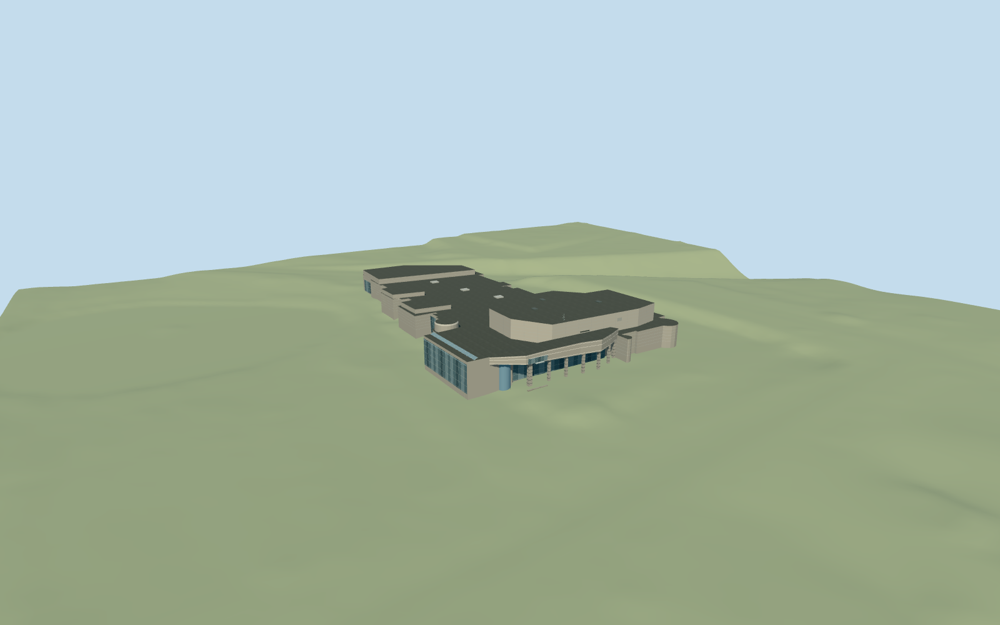

# Tampere Hall

Tampere Hall with the raised entrance arcade, white-tiled auditorium, glass winter garden and blue park-side core.

Authoring state: **review-in-qa.json**. Current completion evidence is in [qa.json](qa.json) and the [completion ledger](../../../../qualla-structures/batches/qualla-003.PROGRESS.md).

- [Tampere Hall](https://qualla.com/tampere-hall/)

The complex follows its mapped exterior. Roof levels, the separate internal volume lengths, column depth, glazing bays and rooftop service fittings are estimated from the contemporary photographs and operator descriptions.

The Sorsapuisto and street views date to 2013 and 2016. Modern parts visible in the current footprint are included with simplified heights. Temporary displays, banners, flags, and exterior art are outside this model.

The connected Courtyard hotel has its own mapped envelope and is excluded from the hall model.

Build: `node content/worldgen/source/places/ud/udb/tampere_hall/models/generate-tampere-hall.mjs`. Add `--check` to verify exact regeneration. 4121 triangles; 6 materials; no embedded photographs.
