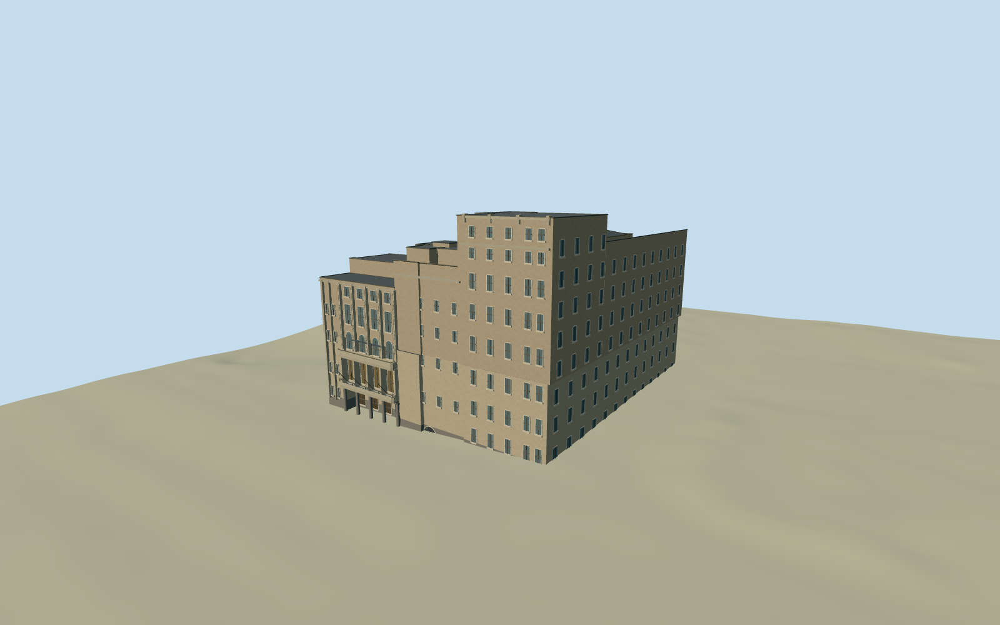

# Tampere Workers' Hall

The historic Tampere Workers’ Hall with its granite colonnade, rounded balconies, stepped corner tower and enclosed courtyard.

Authoring state: **review-in-qa.json**. Current completion evidence is in [qa.json](qa.json) and the [completion ledger](../../../../qualla-structures/batches/qualla-004.PROGRESS.md).

- [Tampere Workers' Hall](https://qualla.com/tampere-workers-hall/)

Unpictured walls, smaller roof profiles, street fittings and unpublished section dimensions are approximate.

Model scope covers the protected hall and courtyard. The adjoining Workers’ Theatre and interior museum exhibits are outside the model scope.

Build: `node content/worldgen/source/places/ud/udb/tampere_workers_hall/models/generate-tampere-workers-hall.mjs`. Add `--check` to verify exact regeneration. 17156 triangles; 6 materials; no embedded photographs.
