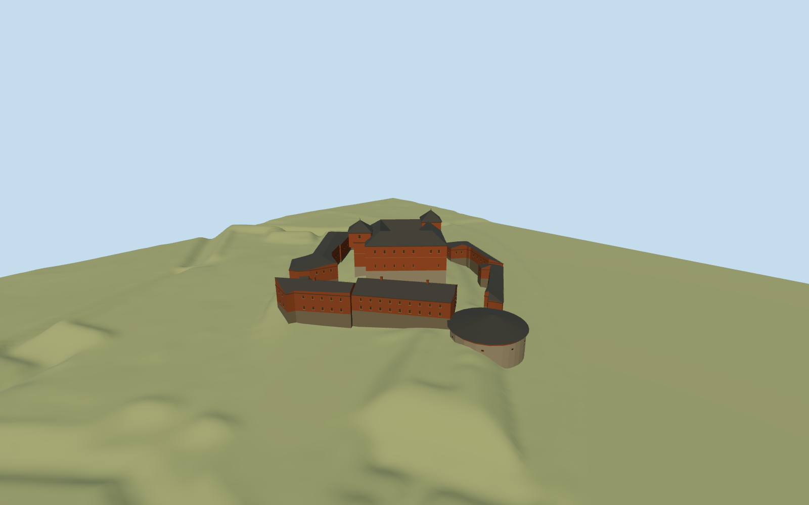

# Häme Castle

Häme Castle as it stands in Hämeenlinna, with its brick keep and open court, outer bailey, Crown Bakery, and round fieldstone cannon tower.

Authoring state: **review-in-qa.json**. Current completion evidence is in [qa.json](qa.json) and the [completion ledger](../../../../qualla-structures/batches/qualla-003.PROGRESS.md).

- [Häme Castle](https://qualla.com/hame-castle/)

Roof pitches, ridge intersections, tower elevations, chimney placement and window heights are visually estimated from the cleared exterior photographs and published building accounts.

The original terrain is untouched. Building floor elevations are estimates and the native terrain represents two-metre relief.

The castle reconstruction omits interior rooms, freestanding peripheral defenses and modern neighboring museum buildings.

Build: `node content/worldgen/source/places/ud/udc/hame_castle/models/generate-hame-castle.mjs`. Add `--check` to verify exact regeneration. 14730 triangles; 5 materials; no embedded photographs.
