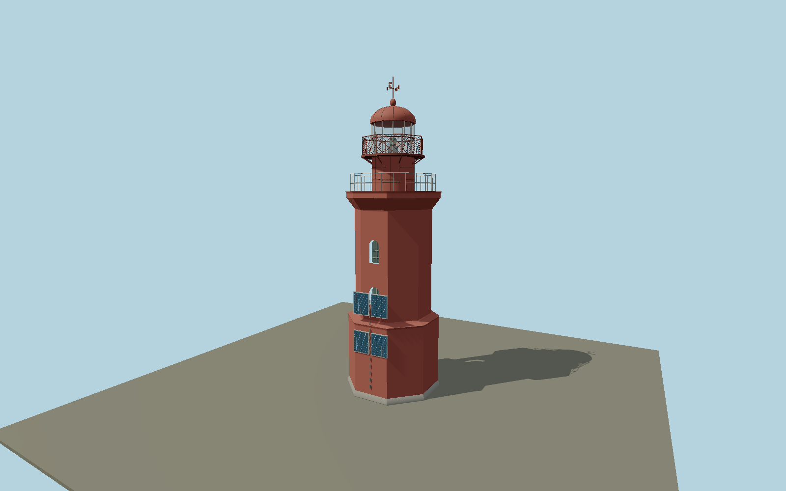

# Rodsher Lighthouse — rodsher

Red octagonal tower with broad lower pedestal, reduced upper shaft, two opposed pairs of deep arched windows, flared masonry gallery, circular railed watch room, four solar panels on the authored+Z facade, wire-mesh lantern balcony, clear framed lantern, riveted domed roof, red ventilator and cardinal vane. Reviewed compass bearing is recorded separately in review-scope.json and map-frame.json.

## Identity and evidence

Exact catalog identity **Q3366505**. Source facts: `{"modeledVaneTopMeters":20.45,"publishedFocalHeightMeters":20,"year":1886,"originalMasterHash":"sha256:4d721aca512bfef94ebd9c45d0c6effccb57189fb9d7e81bc755870fd005106e","sourceSurveyHash":"sha256:6f4e4ad71d894058cf3abe9cd068e4b7d7919139df2d800ae4d4e559ab25debc","surveyControlHeightsMeters":{"baseLedge":4.9,"shaftTop":12.05,"gallery":13.18,"lanternBalcony":15.48,"lanternEave":17.52,"roofGlobe":19.11},"basis":"The project supplies tower location and separate20m navigation-light height. Published survey mesh supplies relative body/lantern dimensions, including20.45m vane tip; its20.75m raw span includes rough ground. No surveyed north axis or EXIF compass was supplied. Solar-wall bearing270degrees true is a photo/context reconstruction with22.5degree uncertainty, not a precise engineering azimuth. OSM keeper-house polygons are contextual controls only, not a lighthouse footprint or part of this model. Clean survey-derived octagonal base is explicitly reconstructed geometry. Detached houses, natural granite shore, exact present paint decay and interior operation are omitted; footprint replacement stays off."}`. The source specification keeps published dimensions separate from reconstructed details.

- https://rgo.ru/activity/project-list/mayak-rodsher/
- https://rgo.ru/upload/content_block/files/246a6930c50362071bf4979ef4a9fd86/67b2fdb8eb2f0694a33c4f35f3af859b6.glb
- https://rgo.ru/upload/content_block/images/2a4874030ffc83a09c95cfbd1b0facbc/679b960d61ef93e1dd48375b7b05fb951.jpg
- https://creativecommons.org/licenses/by/3.0/

Original geometry and shared procedural materials. Official photographs are research references only; no reference imagery or third-party mesh is embedded or redistributed.

## Authored geometry and materials

38,480 triangles, 73,366 vertices, 6 surface groups; 3,106,572 source bytes. SHA-256: `sha256:4d721aca512bfef94ebd9c45d0c6effccb57189fb9d7e81bc755870fd005106e`. Actual bounds: -2.947, 0.000, -3.950 to 2.947, 20.450, 2.960 m.

Shared canonical material graphs with metric UV repeats in extras.molenSurface; portable glTF PBR factors and vertex colors remain. Dark recesses/lantern panels retain local fallback materials. Shared references: `matgraph:molen.worldgen.material.plaster_lime` (2 × 2 m), `matgraph:molen.worldgen.material.metal_painted` (2 × 2 m), `matgraph:molen.worldgen.material.wood_plain` (2 × 0.25 m), `matgraph:molen.worldgen.material.concrete_plain` (2 × 2 m). Model-native axes: {"up":"+Y","front":"+Z","origin":"+Y up; +Z panel wall approximately west, opposite -Z door approximately east. Origin is tower-foot center on host terrain. Official photo viewpoint on the western long keeper-house roof, with northwest hipped house to image-left, signs the panel/door opposition; approximate bearing, not surveyed north."}.

## Placement proposal

+Y up; +Z panel wall approximately west, opposite -Z door approximately east. Origin is tower-foot center on host terrain. Official photo viewpoint on the western long keeper-house roof, with northwest hipped house to image-left, signs the panel/door opposition; approximate bearing, not surveyed north. The project supplies tower location and separate20m navigation-light height. Published survey mesh supplies relative body/lantern dimensions, including20.45m vane tip; its20.75m raw span includes rough ground. No surveyed north axis or EXIF compass was supplied. Solar-wall bearing270degrees true is a photo/context reconstruction with22.5degree uncertainty, not a precise engineering azimuth. OSM keeper-house polygons are contextual controls only, not a lighthouse footprint or part of this model. Clean survey-derived octagonal base is explicitly reconstructed geometry. Detached houses, natural granite shore, exact present paint decay and interior operation are omitted; footprint replacement stays off. Proposed anchor 26.67976, 59.968681 (longitude, latitude), heading -1.5707963267948966 radians. Elevation policy: **terrain-contact**. This is a reviewable proposal, not a completed site-fit certification. Ground models require terrain contact; offshore models also require water-datum and base-height checks.

## Limitations and review

- The modeled exterior follows the cited published facts and inspected photographs. Unpublished dimensions and local fittings are explicitly photo-proportioned; no claim of engineering survey accuracy is made.
- Portable PBR and shared metric surfaces are provided. Surface weathering, material color under local lighting and fine facade relief require close render review before maximum-detail acceptance.
- Published survey/photographic exterior is modeled using clean shared red plaster/iron rather than retaining baked photographic shadows. Thin gallery wire, glass panes and roof hardware are reconstructed as real geometry; surrounding detached derelict houses and island rock terrain remain map features. Small optical hardware is represented only to the detail visible through the lantern. Current maintenance color may vary, but the red daymark and structural arrangement follow the maritime-heritage project.

Near/far fixtures are in `spec.qaCameras`. Float32 finite geometry, triangle degeneracy and winding are checked by the generator. Current rendering, shared-material, maximum-fidelity and geographic review results are recorded in `qa.json` and the readiness ledger; source generation alone does not approve a model.

Regenerate with `node packages/worldgen/scripts/generate-lighthouse-models.mjs --ids=rodsher`; add `--check` for reproducibility. Editable component recipes are in `packages/worldgen/scripts/lighthouse-rodsher-model.mjs`. The generator protects artist-edited master hashes and preserves import/capture/shared-capture/QA documents.
